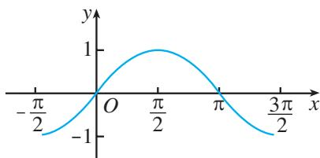

# 正弦函数、余弦函数的单调性

根据正弦函数的周期性，我们可以先在它的一个周期的区间（如 $\left[-\frac{\pi}{2}, \frac{3\pi}{2}\right]$ ）上讨论它的单调性，再利用它的周期性，将单调性扩展到整个定义域.

根据三角函数的周期性，只要把握了它一个周期内的规律，就把握了整个三角函数的规律.

观察图 5.4-8，可以看到：

当 $x$ 由 $-\frac{\pi}{2}$ 增大到 $\frac{\pi}{2}$ 时，曲线逐渐上升， $\sin x$ 的值由-1增大到1；当 $x$ 由 $\frac{\pi}{2}$ 增大到 $\frac{3\pi}{2}$ 时，曲线逐渐下降， $\sin x$ 的值由1减小到-1.

$\sin x$ 的值的变化情况如表5.4-2所示：

图5.4-8  
表5.4-2

<table><tr><td>x</td><td> $-\frac{\pi}{2}$ </td><td>↗</td><td>0</td><td>↗</td><td> $\frac{\pi}{2}$ </td><td>↗</td><td>π</td><td>↗</td><td> $\frac{3\pi}{2}$ </td></tr><tr><td>sin x</td><td>-1</td><td>↗</td><td>0</td><td>↗</td><td>1</td><td>↘</td><td>0</td><td>↘</td><td>-1</td></tr></table>

这就是说，

正弦函数 $y = \sin x$ 在区间 $\left[-\frac{\pi}{2}, \frac{\pi}{2}\right]$ 上单调递增，在区间 $\left[\frac{\pi}{2}, \frac{3\pi}{2}\right]$ 上单调递减. 由正弦函数的周期性可得，

正弦函数在每一个闭区间 $\left[-\frac{\pi}{2} + 2k\pi, \frac{\pi}{2} + 2k\pi\right](k \in \mathbf{Z})$ 上都单调递增，其值从-1增大到1；在每一个闭区间 $\left[\frac{\pi}{2} + 2k\pi, \frac{3\pi}{2} + 2k\pi\right](k \in \mathbf{Z})$ 上都单调递减，其值从1减小到-1.

类似地，观察余弦函数在一个周期区间（如 $[- \pi, \pi]$ ）上函数值的变化规律，将看到的函数值的变化情况填入表5.4-3：

表5.4-3

<table><tr><td>x</td><td>-π</td><td>↗</td><td>-π/2</td><td>↗</td><td>0</td><td>↗</td><td>π/2</td><td>↗</td><td>π</td></tr><tr><td>cos x</td><td></td><td></td><td></td><td></td><td></td><td></td><td></td><td></td><td></td></tr></table>

由此可得，

函数 $y = \cos x, x \in [-\pi, \pi]$ 在区间 \_\_\_\_ 上单调递增，其值从 -1 增大到 1；在区间 \_\_\_\_ 上单调递减，其值从 1 减小到 -1.

由余弦函数的周期性可得，

余弦函数在每一个闭区间 \_\_\_\_ 上都单调递增，其值从 -1 增大到 1；在每一个闭区间 \_\_\_\_ 上都单调递减，其值从 1 减小到 -1.
