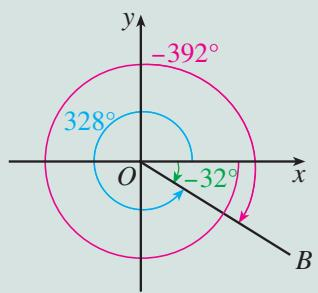

# 终边相同的角

探究

将角按照上述方法放在直角坐标系中后，给定一个角，就有唯一的一条终边与之对应。反之，对于直角坐标系内任意一条射线 OB（图 5.1-6），以它为终边的角是否唯一？如果不唯一，那么终边相同的角有什么关系？

  
图5.1-6

不难发现，在图 5.1-6 中，如果 $-32^{\circ}$ 角的终边是 OB，那么 $328^{\circ}$ ， $-392^{\circ}$ ，…角的终边都是 OB，并且与 $-32^{\circ}$ 角终边相同的这些角都可以表示成 $-32^{\circ}$ 的角与 k 个 $(k \in \mathbf{Z})$ 周角的和，如

$$
\begin{array}{r l} & 3 2 8 ^ {\circ} = - 3 2 ^ {\circ} + 3 6 0 ^ {\circ} (\text {这里} k = \_) \\ & - 3 9 2 ^ {\circ} = - 3 2 ^ {\circ} - 3 6 0 ^ {\circ} (\text {这里} k = \_) \end{array}
$$

设 $S = \{\beta \mid \beta = -32^{\circ} + k \cdot 360^{\circ}, k \in \mathbf{Z}\}$ ，则 $328^{\circ}$ ， $-392^{\circ}$ 角都是 $S$ 的元素， $-32^{\circ}$ 角也是 $S$ 的元素（此时 $k = \_$ ）。因此，所有与 $-32^{\circ}$ 角终边相同的角，连同 $-32^{\circ}$ 角在内，都是集合 $S$ 的元素；反过来，集合 $S$ 的任一元素显然与 $-32^{\circ}$ 角的终边相同。

一般地，我们有：

所有与角 $\alpha$ [终边相同的角](../%E6%A6%82%E5%BF%B5%E6%88%96%E5%85%AC%E5%BC%8F/%E6%A6%82%E5%BF%B5-%E7%BB%88%E8%BE%B9%E7%9B%B8%E5%90%8C%E7%9A%84%E8%A7%92.md)，连同角 $\alpha$ 在内，可构成一个集合

$$
S = \{\beta \mid \beta = \alpha + k \cdot 3 6 0 ^ {\circ}, k \in \mathbf {Z} \},
$$

即任一与角 $\alpha$ 终边相同的角，都可以表示成角 $\alpha$ 与整数个周角的和.
