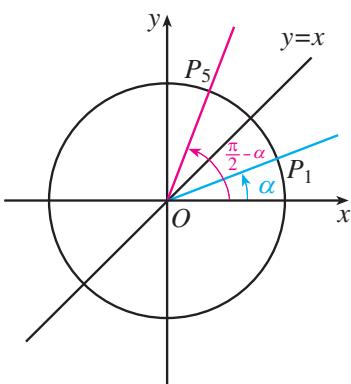

作 $P_{1}$ 关于直线 $y = x$ 的对称点 $P_{5}$ ，以 $OP_{5}$ 为终边的角 $\gamma$ 与角 $\alpha$ 有什么关系？角 $\gamma$ 与角 $\alpha$ 的三角函数值之间有什么关系？

如图5.3-5，以 $OP_{5}$ 为终边的角 $\gamma$ 都是与角 $\frac{\pi}{2} -\alpha$ 终边相同的角，即 $\gamma = 2k\pi +\left(\frac{\pi}{2} -\alpha\right)$ $(k\in \mathbf{Z})$ ，因此，只要探究角 $\frac{\pi}{2} -\alpha$ 与 $\alpha$ 的三角函数值之间的关系即可.

设 $P_{5}(x_{5},y_{5})$ ，由于 $P_{5}$ 是点 $P_{1}$ 关于直线 $y = x$ 的对称点，可以证明

$$
x _ {5} = y _ {1}, \quad y _ {5} = x _ {1}.\tag{①}
$$

根据三角函数的定义，得

$$
\sin \left(\frac {\pi}{2} - \alpha\right) = y _ {5}, \cos \left(\frac {\pi}{2} - \alpha\right) = x _ {5}.
$$

从而得

公式五

图5.3-5

$$
\sin \left(\frac {\pi}{2} - \alpha\right) = \cos \alpha ,
$$

$$
\cos \left(\frac {\pi}{2} - \alpha\right) = \sin \alpha .
$$

?

你能利用平面几何的知识，就图5.3-5所示的情况证明①式吗？其他情况呢？

作 $P_{5}$ 关于 $y$ 轴的对称点，又能得到什么结论？

类似地，可得

公式六

$$
\sin \left(\frac {\pi}{2} + \alpha\right) = \cos \alpha ,
$$

$$
\cos \left(\frac {\pi}{2} + \alpha\right) = - \sin \alpha .
$$

角 $\frac{\pi}{2} + \alpha$ 的终边与角 $\alpha$ 的终边具有怎样的对称性？据此你将如何证明公式六？

利用公式五或公式六，可以实现正弦函数与余弦函数的相互转化.

公式一～公式六都叫做诱导公式.
