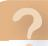

# 集合相等与真子集

一般地，如果集合 A 的任何一个元素都是集合 B 的元素，同时集合 B 的任何一个元素都是集合 A 的元素，那么集合 A 与集合 B 相等，记作 A=B .

请你举出几个具有包含关系、相等关系的集合实例.

也就是说，若 $A \subseteq B$ ，且 $B \subseteq A$ ，则 $A = B$ .

如果集合 $A \subseteq B$ ，但存在元素 $x \in B$ ，且 $x \notin A$ ，就称集合 $A$ 是集合 $B$ 的真子集（proper subset），记作

$$
A \subsetneqq B (\text {或} B \supsetneqq A),
$$

与实数中的结论“若 $a \geqslant b$ ，且 $b \geqslant a$ ，则 $a = b$ ”相类比，你有什么体会？

读作 “A 真包含于 B”（或 “B 真包含 A”）.

例如，在（1）中， $A \subseteq B$ ，但 $4 \in B$ ，且 $4 \notin A$ ，所以集合 A 是集合 B 的真子集.
