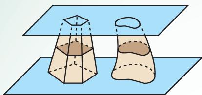
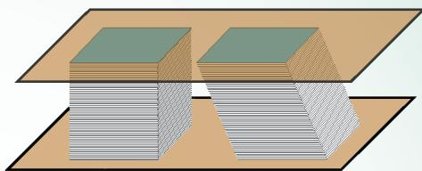

# 祖暅原理

## 高中必修 第二册·人教A版数学

祖暅（gèng）（5世纪—6世纪），字景烁，祖冲之之子，范阳郡遒县（今河北省涞水县）人，南北朝时期的伟大科学家。祖暅在数学上做出了突出贡献，他在实践的基础上，于5世纪末提出了下面的体积计算原理：“幂势既同，则积不容异”。这就是“祖暅原理”。“势”即是高，“幂”是面积，祖暅原理用现代语言可以描述为：

夹在两个平行平面之间的两个几何体，被平行于这两个平面的任意平面所截，如果截得的两个截面的面积总相等，那么这两个几何体的体积相等.

如图 1，夹在平行平面间的两个几何体（它们的形状可以不同），被平行于这两个平面的任何一个平面所截，如果截面（阴影部分）的面积都相等，那么这两个几何体的体积一定相等.

  
图1

  
图2

这个原理是非常浅显易懂的。例如，取一摞纸堆放在桌面上组成一个几何体（图2），使它倾斜一个角度，这时几何体的形状发生了改变，得到了另一个几何体，但两个几何体的高度没有改变，每页纸的面积也没有改变，因而两个几何体的体积相等。利用这个原理和长方体体积公式，我们能够求出柱体、锥体、台体和球体的体积。

祖暅给出上面的原理，要比其他国家的数学家早一千多年。在欧洲直到17世纪，意大利数学家卡瓦列里（Bonaventura Cavalieri，1598—1647）才给出上述结论。

## 所属组织

- [探究与发现 祖暅原理与柱体、锥体的体积](../%E7%9F%A5%E8%AF%86%E4%B8%B2%E8%81%94/%E4%BA%BA%E6%95%99A-%E5%BF%85%E4%BF%AE%E7%AC%AC%E4%BA%8C%E5%86%8C/%E7%AC%AC%E5%85%AB%E7%AB%A0%20%E7%AB%8B%E4%BD%93%E5%87%A0%E4%BD%95%E5%88%9D%E6%AD%A5/%E6%8E%A2%E7%A9%B6%E4%B8%8E%E5%8F%91%E7%8E%B0%20%E7%A5%96%E6%9A%85%E5%8E%9F%E7%90%86%E4%B8%8E%E6%9F%B1%E4%BD%93%E3%80%81%E9%94%A5%E4%BD%93%E7%9A%84%E4%BD%93%E7%A7%AF.md)

## 相关练习组织（范围关联）

- [第八章 立体几何初步](../%E9%A2%98%E5%9E%8B/%E6%8C%89%E7%AB%A0%E8%8A%82%E5%88%86%E7%B1%BB/%E4%BA%BA%E6%95%99A-%E5%BF%85%E4%BF%AE%E7%AC%AC%E4%BA%8C%E5%86%8C/%E7%AC%AC%E5%85%AB%E7%AB%A0%20%E7%AB%8B%E4%BD%93%E5%87%A0%E4%BD%95%E5%88%9D%E6%AD%A5/%E7%AC%AC%E5%85%AB%E7%AB%A0%20%E7%AB%8B%E4%BD%93%E5%87%A0%E4%BD%95%E5%88%9D%E6%AD%A5.md)

<!-- BEGIN mathmap-knowledge-contribution:mst-conics-2026 -->
## 题型训练 · 2026版高中《mst老唐说题》圆锥曲线专题（数学）

### 圆锥曲线四定义 / 第七节 截口曲线与祖暅原理

> [!example]- 三、祖暅原理
> 

<!-- END mathmap-knowledge-contribution:mst-conics-2026 -->
