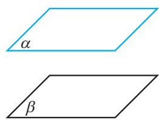

# 空间中平面与平面的位置关系

## 高中必修 第二册·人教A版数学

在图 8.4-11 中，平面 ABCD 与平面 $A^{\prime}B^{\prime}C^{\prime}D^{\prime}$ 没有公共点；平面 ABCD 与平面 $BCC^{\prime}B^{\prime}$ 有一条公共直线 BC。再结合生活实例，我们可以看出，两个平面之间的位置关系有且只有以下两种：

(1) 两个平面平行——没有公共点；

(2) 两个平面相交——有一条公共直线.

画两个互相平行的平面时，要注意使表示平面的两个平行四边形的对应边平行（图8.4-14）.

图8.4-14

平面 $\alpha$ 与平面 $\beta$ 平行，记作 $\alpha // \beta$ .
