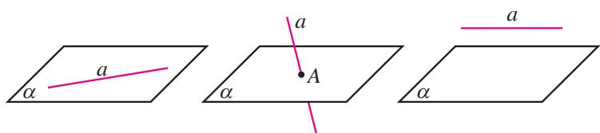

# 空间中直线与平面的位置关系

## 高中必修 第二册·人教A版数学

在图 8.4-11 中，直线 AB 与平面 ABCD 有无数个公共点；直线 $AA'$ 与平面 ABCD 只有一个公共点 A；直线 $A'B'$ 与平面 ABCD 没有公共点。再结合生活实例，我们可以看出，直线与平面的位置关系有且只有三种：

(1) 直线在平面内——有无数个公共点；

(2) 直线与平面相交——有且只有一个公共点；

(3) 直线与平面平行——没有公共点.

当直线与平面相交或平行时，直线不在平面内，也称为直线在平面外.

图 8.4-13 表示了直线与平面的三种位置关系.

  
图8.4-13

一般地，直线 a 在平面 $\alpha$ 内，应把直线 a 画在表示平面 $\alpha$ 的平行四边形内；直线 a 在平面 $\alpha$ 外，应把直线 a 或它的一部分画在表示平面 $\alpha$ 的平行四边形外.

直线 a 与平面 $\alpha$ 相交于点 A，记作 $a \cap \alpha = A$ ；直线 a 与平面 $\alpha$ 平行，记作 $a \parallel \alpha$ .
