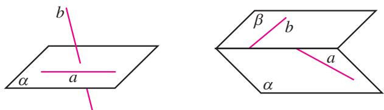

# 空间中直线与直线的位置关系

## 高中必修 第二册·人教A版数学

在图 8.4-11 中，直线 AB 与 DC 在同一个平面 ABCD 内，它们没有公共点，它们是平行直线；直线 AB 与 BC 也在同一个平面 ABCD 内，它们只有一个公共点 B，它们是相交直线；直线 AB 与 $CC'$ 不同在任何一个平面内.

我们把不同在任何一个平面内的两条直线叫做异面直线．于是，空间两条直线的位置关系有三种：

共面直线{相交直线：在同一平面内，有且只有一个公共点；

平行直线：在同一平面内，没有公共点；

异面直线：不同在任何一个平面内，没有公共点.

这样，空间中两条直线平行和我们学过的平面上两条直线平行的意义是一致的，即首先这两条直线在同一平面内，其次是它们不相交。如果直线 $a$ ， $b$ 为异面直线，为了表示它们不共面的特点，作图时，通常用一个或两个平面衬托，如图8.4-12所示。

  
图8.4-12
