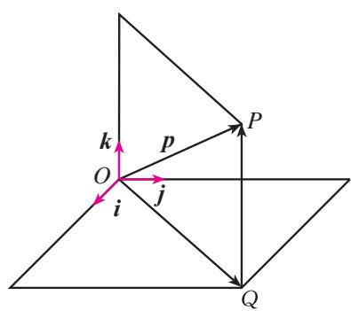

# 空间向量基本定理及其证明

## 高中选择性必修 第一册·人教A版数学

我们先从空间中三个不共面的向量两两垂直这一特殊情况开始讨论.

如图 1.2-1，设 i, j, k 是空间中三个两两垂直的向量，且表示它们的有向线段有公共起点 O。对于任意一个空间向量 $p = \overrightarrow{OP}$ ，设 $\overrightarrow{OQ}$ 为 $\overrightarrow{OP}$ 在 i，j 所确定的平面上的投影向量，则 $\overrightarrow{OP} = \overrightarrow{OQ} + \overrightarrow{QP}$ 。又向量 $\overrightarrow{QP}$ ，k 共线，因此存在唯一的实数 z，使得 $\overrightarrow{QP} = zk$ ，从而

$$
\overrightarrow {O P} = \overrightarrow {O Q} + z k.
$$

而在 $i, j$ 所确定的平面上，由平面向量基本定理可知，存在唯一的有序实数对 $(x, y)$ ，使得

  
图1.2-1

$$
\overrightarrow {O Q} = x \mathbf {i} + y \mathbf {j}.
$$

从而

$$
\overrightarrow {O P} = \overrightarrow {O Q} + z k = x i + y j + z k.
$$

因此，如果 i, j, k 是空间三个两两垂直的向量，那么对任意一个空间向量 p，存在唯一的有序实数组 $(x, y, z)$ ，使得

$$
\boldsymbol {p} = x \boldsymbol {i} + y \boldsymbol {j} + z \boldsymbol {k}.
$$

你能证明唯一性吗？

我们称 $xi$ ， $yj$ ， $zk$ 分别为向量 $p$ 在 $i$ ， $j$ ， $k$ 上的分向量.

探究

在空间中，如果用任意三个不共面的向量 $a, b, c$ 代替两两垂直的向量 $i, j, k$ ，你能得出类似的结论吗？

类似平面向量基本定理，我们有空间向量基本定理.

定理 如果三个向量 $a, b, c$ 不共面，那么对任意一个空间向量 $p$ ，存在唯一的有序实数组 $(x, y, z)$ ，使得

$$
\boldsymbol {p} = x \boldsymbol {a} + y \boldsymbol {b} + z \boldsymbol {c}.
$$

请你自己给出空间向量基本定理的证明.

(第3题)

由此可知，如果三个向量 $a, b, c$ 不共面，那么所有空间向量组成的集合就是 $\{p \mid p = xa + yb + zc, x, y, z \in \mathbf{R}\}$ 。这个集合可看作由向量 $a, b, c$ 生成的，我们把 $\{a, b, c\}$ 叫做空间的一个基底（base）， $a, b, c$ 都叫做基向量（base vectors）。空间任意三个不共面的向量都可以构成空间的一个基底。

特别地，如果空间的一个基底中的三个基向量两两垂直，且长度都为1，那么这个基底叫做单位正交基底，常用 $\{i, j, k\}$ 表示．由空间向量基本定理可知，对空间中的任意向量 a，均可以分解为三个向量 xi，yj，zk，使 $a = xi + yj + zk$ ．像这样，把一个空间向量分解为三个两两垂直的向量，叫做把空间向量进行正交分解.

由空间向量基本定理可知，如果把三个不共面的向量作为空间的一个基底，那么所有空间向量都可以用三个基向量表示出来。进一步地，所有空间向量间的运算都可以转化为基向量间的运算，这为解决问题带来了方便。
