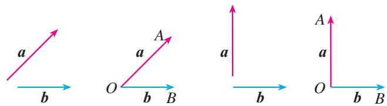
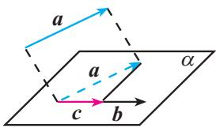
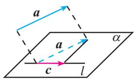
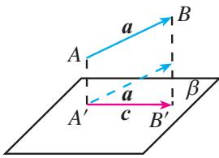

由于任意两个空间向量都可以通过平移转化为同一平面内的向量，因此，两个空间向量的夹角和数量积就可以像平面向量那样来定义.

如图1.1-10，已知两个非零向量 $a, b$ ，在空间任取一点 $O$ ，作 $\overrightarrow{OA} = a$ ， $\overrightarrow{OB} = b$ ，则 $\angle AOB$ 叫做向量 $a, b$ 的夹角，记作 $\langle a, b \rangle$

  
图1.1-10

通常规定， $0 \leqslant \langle a, b \rangle \leqslant \pi$ 。这样，两个向量的夹角是唯一确定的，且 $\langle a, b \rangle = \langle b, a \rangle$ .

如果 $\langle a, b \rangle = \frac{\pi}{2}$ ，那么向量 $a, b$ 互相垂直，记作 $a \perp b$ .

已知两个非零向量 a, b，则 $\left|a\right|\left|b\right|\cos\langle a, b\rangle$ 叫做 a, b 的数量积（inner product），记作 $a \cdot b$ ．即

$$
\boldsymbol {a} \cdot \boldsymbol {b} = | \boldsymbol {a} | | \boldsymbol {b} | \cos \langle \boldsymbol {a}, \boldsymbol {b} \rangle .
$$

特别地，零向量与任意向量的数量积为 0.

由向量的数量积定义，当 $a \neq 0$ ， $b \neq 0$ 时，可以得到：

$$
\boldsymbol {a} \perp \boldsymbol {b} \Leftrightarrow \boldsymbol {a} \cdot \boldsymbol {b} = 0;
$$

$$
\boldsymbol {a} \cdot \boldsymbol {a} = | \boldsymbol {a} | | \boldsymbol {a} | \cos \langle \boldsymbol {a}, \boldsymbol {a} \rangle = | \boldsymbol {a} | ^ {2}.
$$

$a \cdot a$ 也记作 $a^{2}$ .

在平面向量的学习中，我们学习了向量的投影。类似地，在空间中，向量可以分别向向量、直线和平面进行投影。

如图1.1-11(1)，在空间，向量 $a$ 向向量 $b$ 投影，由于它们是自由向量，因此可以先将它们平移到同一个平面 $\alpha$ 内，进而利用平面上向量的投影，得到与向量 $b$ 共线的向量 $c$ ， $c = |a|\cos \langle a,b\rangle \frac{b}{|b|}$ ，向量 $c$ 称为向量 $a$ 在向量 $b$ 上的投影向量．类似地，可以将向量 $a$ 向直线 $l$ 投影（图1.1-11(2))。

  
(1)

  
(2)  
图1.1-11

  
(3)

如图 1.1-11（3），向量 a 向平面 $\beta$ 投影，就是分别由向量 a 的起点 A 和终点 B 作平面 $\beta$ 的垂线，垂足分别为 $A'$ ， $B'$ ，得到向量 $\overrightarrow{A'B'}$ ，向量 $\overrightarrow{A'B'}$ 称为向量 a 在平面 $\beta$ 上的投影向量。这时，向量 a， $\overrightarrow{A'B'}$ 的夹角就是向量 a 所在直线与平面 $\beta$ 所成的角。

空间向量的数量积满足如下的运算律：

$(\lambda a) \cdot b = \lambda (a \cdot b), \lambda \in \mathbf{R};$

$a \cdot b = b \cdot a$ （交换律）；

$(a+b)\cdot c=a\cdot c+b\cdot c$ （分配律）.
