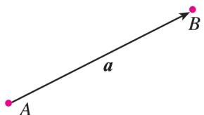
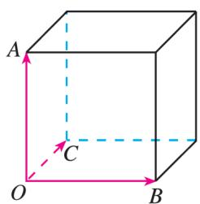
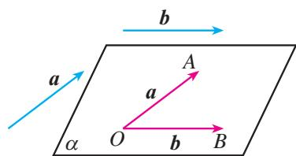
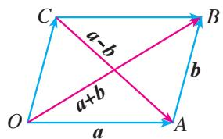
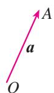
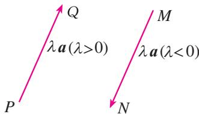
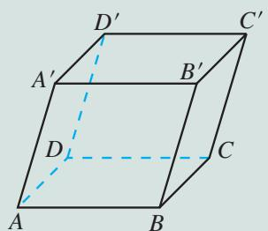
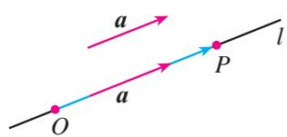
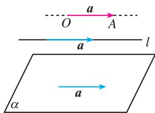

与平面向量一样，在空间，我们把具有大小和方向的量叫做空间向量（space vector），空间向量的大小叫做空间向量的长度或模（modulus）。空间向量用字母 $a^{①}$ ，b，c，…表示。空间中点的位移、物体运动的速度、物体受到的力等都可以用空间向量表示。

与平面向量一样，空间向量也用有向线段表示，有向线段的长度表示空间向量的模．如图1.1-1，向量a的起点是A，终点是B，则向量a也可以记作 $\overrightarrow{AB}$ ，其模记为 $|a|$ 或 $|\overrightarrow{AB}|$ ．图1.1-2所示的正方体中，过同一个顶点O的三条棱上的三条有向线段表示的三个向量为 $\overrightarrow{OA}$ ， $\overrightarrow{OB}$ ， $\overrightarrow{OC}$ ，它们是不共面的向量，即它们是不同在任何一个平面内的三个向量．

与平面向量一样，我们规定，长度为0的向量叫做零向量（zero vector），记为0．当有向线段的起点A与终点B重合时， $\overrightarrow{AB}=0$ ．模为1的向量叫做单位向量（unit vector）．与向量a长度相等而方向相反的向量，叫做a的相反向量，记为-a.

如果表示若干空间向量的有向线段所在的直线互相平行或重合，那么这些向量叫做共线向量（collinear vectors）或平行向量（parallel vectors）。我们规定：零向量与任意向量平行，即对于任意向量 a，都有 0//a。

①印刷用黑体 a，书写用 $\vec{a}$ .

  
图1.1-1

  
图1.1-2

空间向量是平面向量的推广，其表示方法以及一些相关概念与平面向量一致。

方向相同且模相等的向量叫做相等向量（equal vectors）。因此，在空间，同向且等长的有向线段表示同一向量或相等向量。空间向量是自由的，所以对于空间中的任意两个非零向量，我们都可以通过平移使它们的起点重合。因为两条相交直线确定一个平面，所以起点重合的两个不共线向量可以确定一个平面，也就是说，任意两个空间向量都可以平移到同一个平面内，成为同一平面内的两个向量。如图1.1-3，已知空间向量 $a$ ， $b$ ，以任意点 $O$ 为起点，作向量 $\overrightarrow{OA} = a$ ， $\overrightarrow{OB} = b$ ，我们就可以把它们平移到同一个平面 $\alpha$ 内。

数学中，引进一种量后，一个很自然的问题就是要研究它们的运算。由于任意两个空间向量都可以通过平移转化为同一平面内的向量，这样任意两个空间向量的运算就可以转化为平面向量的运算。由此，我们把平面向量的线性运算推广到空间，定义空间向量的加法、减法（图1.1-4）以及数乘运算（图1.1-5）：

  
图1.1-3

(1) $a + b = \overrightarrow{OA} +\overrightarrow{AB} = \overrightarrow{OB};$

(2) $a - b = \overrightarrow{OA} -\overrightarrow{OC} = \overrightarrow{CA};$

(3) 当 $\lambda > 0$ 时， $\lambda a = \lambda \overrightarrow{OA} = \overrightarrow{PQ}$ ;

当 $\lambda < 0$ 时， $\lambda a = \lambda \overrightarrow{OA} = \overrightarrow{MN}$ ；

当 $\lambda=0$ 时， $\lambda a=0$ .

  
图1.1-4

  
图1.1-5

与平面向量一样，空间向量的线性运算满足以下运算律（其中 $\lambda, \mu \in \mathbf{R}$ ）：

交换律： $a+b=b+a$ ;

结合律： $(a+b)+c=a+(b+c)$ ， $\lambda(\mu a)=(\lambda\mu)a$ ；

分配律： $(\lambda +\mu)a = \lambda a + \mu a$ ， $\lambda (a + b) = \lambda a + \lambda b.$

如图 1.1-6，在平行六面体 $ABCD-A'B'C'D'$ 中，比较 $\overrightarrow{AB}+\overrightarrow{AD}+\overrightarrow{AA'}$ 与 $\overrightarrow{AB}+\overrightarrow{AA'}+\overrightarrow{AD}$ 所表示的向量，可以发现， $\overrightarrow{AB} + \overrightarrow{AD} + \overrightarrow{AA'} = \overrightarrow{AB} + \overrightarrow{AA'} + \overrightarrow{AD} = \overrightarrow{AC'}$ 。

  
图1.1-6

一般地，对于三个不共面的向量 $a, b, c$ ，以任意点 $O$ 为起点， $a, b, c$ 为邻边作平行六面体，则 $a, b, c$ 的和等于以 $O$ 为起点的平行六面体对角线所表示的向量。另外，利用向量加法的交换律和结合律，还可以得到：有限个向量求和，交换相加向量的顺序，其和不变。

类似于平面向量共线的充要条件，对任意两个空间向量 $a$ ， $b(b\neq 0)$ ， $a / / b$ 的充要条件是存在实数 $\lambda$ ，使

$$
\boldsymbol {a} = \lambda \boldsymbol {b}.
$$

如图 1.1-7，O 是直线 l 上一点，在直线 l 上取非零向量 a，则对于直线 l 上任意一点 P，由数乘向量的定义及向量共线的充要条件可知，存在实数 $\lambda$ ，使得

$$
\overrightarrow {O P} = \lambda \boldsymbol {a}.
$$

  
图1.1-7

我们把与向量 a 平行的非零向量称为直线 l 的方向向量（direction vector）。这样，直线 l 上任意一点都可以由直线 l 上的一点和它的方向向量表示，也就是说，直线可以由其上一点和它的方向向量确定。

如图 1.1-8，如果表示向量 a 的有向线段 $\overrightarrow{OA}$ 所在的直线 OA 与直线 l 平行或重合，那么称向量 a 平行于直线 l。如果直线 OA 平行于平面 $\alpha$ 或在平面 $\alpha$ 内，那么称向量 a 平行于平面 $\alpha$ 。平行于同一个平面的向量，叫做共面向量 (coplanar vectors)。

  
图1.1-8

任意两个空间向量总是共面的，但三个空间向量既可能是共面的，也可能是不共面的。对平面内任意两个不共线向量 $a, b$ ，由平面向量基本定理可知，这个平面内的任意一个向量 $p$ 可以写成 $p = xa + yb$ ，其中 $(x, y)$ 是唯一确定的有序实数对。推广到空间向量，如果两个向量 $a$ ， $b$ 不共线，那么向量 $\boldsymbol{p}$ 与向量 $a$ ， $b$ 共面的充要条件是存在唯一的有序实数对 $(x, y)$ ，使

$$
\boldsymbol {p} = x \boldsymbol {a} + y \boldsymbol {b}.
$$
