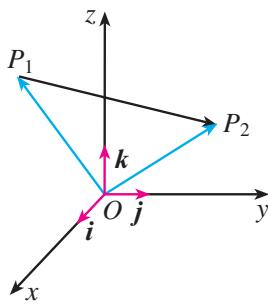

设

$$
\boldsymbol {a} = \left(a _ {1}, a _ {2}, a _ {3}\right), \boldsymbol {b} = \left(b _ {1}, b _ {2}, b _ {3}\right),
$$

与平面向量运算的坐标表示一样，我们有：

$$
\boldsymbol {a} + \boldsymbol {b} = (a _ {1} + b _ {1}, a _ {2} + b _ {2}, a _ {3} + b _ {3}),
$$

$$
\boldsymbol {a} - \boldsymbol {b} = \left(a _ {1} - b _ {1}, a _ {2} - b _ {2}, a _ {3} - b _ {3}\right),
$$

$$
\lambda \boldsymbol {a} = (\lambda a _ {1}, \lambda a _ {2}, \lambda a _ {3}), \lambda \in \mathbf {R},
$$

$$
\boldsymbol {a} \cdot \boldsymbol {b} = a _ {1} b _ {1} + a _ {2} b _ {2} + a _ {3} b _ {3}.
$$

下面我们证明空间向量数量积运算的坐标表示.

设 $\{i,j,k\}$ 为空间的一个单位正交基底，则

$$
\boldsymbol {a} = a _ {1} \boldsymbol {i} + a _ {2} \boldsymbol {j} + a _ {3} \boldsymbol {k}, \boldsymbol {b} = b _ {1} \boldsymbol {i} + b _ {2} \boldsymbol {j} + b _ {3} \boldsymbol {k},
$$

所以

$$
\boldsymbol {a} \cdot \boldsymbol {b} = \left(a _ {1} \boldsymbol {i} + a _ {2} \boldsymbol {j} + a _ {3} \boldsymbol {k}\right) \cdot \left(b _ {1} \boldsymbol {i} + b _ {2} \boldsymbol {j} + b _ {3} \boldsymbol {k}\right).
$$

其他运算的坐标表示可以类似证明，请同学们自己完成.

利用向量数量积的分配律以及

$$
i \cdot i = j \cdot j = k \cdot k = 1, i \cdot j = j \cdot k = k \cdot i = 0,
$$

得

$$
\boldsymbol {a} \cdot \boldsymbol {b} = a _ {1} b _ {1} + a _ {2} b _ {2} + a _ {3} b _ {3}.
$$

由上述结论可知，空间向量运算的坐标表示与平面向量运算的坐标表示是完全一致的．例如，我们有：

一个空间向量的坐标等于表示此向量的有向线段的终点坐标减去起点坐标.

类似平面向量运算的坐标表示，我们还可以得到：

当 $b \neq 0$ 时， $a // b \Leftrightarrow a = \lambda b \Leftrightarrow a_{1} = \lambda b_{1}$ ， $a_{2} = \lambda b_{2}$ ， $a_{3} = \lambda b_{3} (\lambda \in \mathbf{R})$ ;

当 $a \neq 0, b \neq 0$ 时， $a \perp b \Leftrightarrow a \cdot b = 0 \Leftrightarrow a_1b_1 + a_2b_2 + a_3b_3 = 0$ ;

$$
\left| \boldsymbol {a} \right| = \sqrt {\boldsymbol {a} \cdot \boldsymbol {a}} = \sqrt {a _ {1} ^ {2} + a _ {2} ^ {2} + a _ {3} ^ {2}};
$$

$$
\cos \langle \boldsymbol {a}, \boldsymbol {b} \rangle = \frac {\boldsymbol {a} \cdot \boldsymbol {b}}{| \boldsymbol {a} | | \boldsymbol {b} |} = \frac {a _ {1} b _ {1} + a _ {2} b _ {2} + a _ {3} b _ {3}}{\sqrt {a _ {1} ^ {2} + a _ {2} ^ {2} + a _ {3} ^ {2}} \sqrt {b _ {1} ^ {2} + b _ {2} ^ {2} + b _ {3} ^ {2}}}.
$$

利用空间向量运算的坐标表示，还可以推导出空间两点间的距离公式。

如图1.3-7建立空间直角坐标系 $Oxyz$ ，设 $P_{1}(x_{1},y_{1},z_{1})$ $P_{2}(x_{2},y_{2},z_{2})$ 是空间中任意两点，则

$$
\overrightarrow {P _ {1} P _ {2}} = \overrightarrow {O P _ {2}} - \overrightarrow {O P _ {1}} = \left(x _ {2} - x _ {1}, y _ {2} - y _ {1}, z _ {2} - z _ {1}\right).
$$

于是

$$
\begin{array}{r l} \left| \overrightarrow {P _ {1} P _ {2}} \right| & = \sqrt {\overrightarrow {P _ {1} P _ {2}} \cdot \overrightarrow {P _ {1} P _ {2}}} \\ & = \sqrt {(x _ {2} - x _ {1}) ^ {2} + (y _ {2} - y _ {1}) ^ {2} + (z _ {2} - z _ {1}) ^ {2}}. \end{array}
$$

  
图1.3-7

所以

$$
P _ {1} P _ {2} = \left| \overrightarrow {P _ {1} P _ {2}} \right| = \sqrt {\left(x _ {2} - x _ {1}\right) ^ {2} + \left(y _ {2} - y _ {1}\right) ^ {2} + \left(z _ {2} - z _ {1}\right) ^ {2}}.
$$

这就是空间两点间的距离公式.

将空间向量的运算与向量的坐标表示结合起来，不仅可以解决夹角和距离的计算问题，而且可以使一些问题的解决变得简单.
