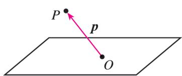
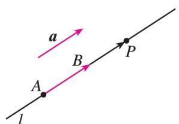
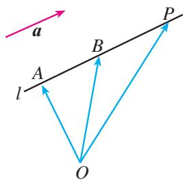
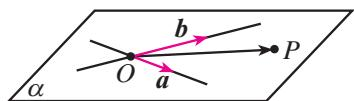
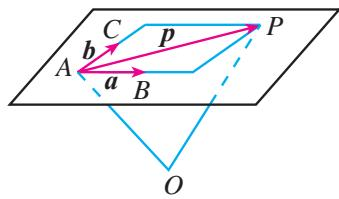
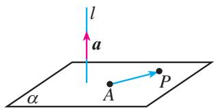

1. 空间中点、直线和平面的向量表示

我们知道，点、直线和平面是空间的基本图形，点、线段和平面图形等是组成空间几何体的基本元素。因此，为了用空间向量解决立体几何问题，首先要用向量表示空间中的点、直线和平面。

对于空间中的点，如图 1.4-1，在空间中，我们取一定点 O 作为基点，那么空间中任意一点 P 就可以用向量 $\overrightarrow{OP}$ 来表示。我们把向量 $\overrightarrow{OP}$ 称为点 P 的位置向量。

  
图1.4-1

空间中给定一个点 $A$ 和一个方向就能唯一确定一条直线 $l$ 。用向量表示直线 $l$ ，就是要利用点 $A$ 和直线 $l$ 的方向向量表示直线上的任意一点。

如图 1.4-2, a 是直线 l 的方向向量，在直线 l 上取 $\overrightarrow{AB}=a$ ，设 P 是直线 l 上的任意一点，由向量共线的条件可知，点 P 在直线 l 上的充要条件是存在实数 t，使得

  
图1.4-2

$$
\overrightarrow {A P} = t \boldsymbol {a}, \text {即} \overrightarrow {A P} = t \overrightarrow {A B}.
$$

进一步地，如图1.4-3，取定空间中的任意一点 $O$ ，可以得到点 $P$ 在直线 $l$ 上的充要条件是存在实数 $t$ ，使

$$
\overrightarrow {O P} = \overrightarrow {O A} + t \boldsymbol {a},\tag{①}
$$

  
图1.4-3

将 $\overrightarrow{AB} = a$ 代入①式，得

$$
\overrightarrow {O P} = \overrightarrow {O A} + t \overrightarrow {A B}.\tag{②}
$$

①式和②式都称为空间直线的向量表示式．由此可知，空间任意直线由直线上一点及直线的方向向量唯一确定.

对于空间中的平面，既可以由一个定点和两个不共线的定方向确定，也可以由一个定点和一个定方向（法向量）确定。

我们知道，平面 $\alpha$ 可以由 $\alpha$ 内两条相交直线确定．如图1.4-4，设两条直线相交于点 $O$ ，它们的方向向量分别为 $\pmb{a}$ 和 $\pmb{b}$ ， $P$ 为平面 $\alpha$ 内任意一点，由平面向量基本定理可知，存在唯一的有序实数对 $(x,y)$ ，使得

$$
\overrightarrow {O P} = x \boldsymbol {a} + y \boldsymbol {b}.
$$

这样，点 $O$ 与向量 $\pmb{a}$ ， $\pmb{b}$ 不仅可以确定平面 $\alpha$ ，还可以具体表示出 $\alpha$ 内的任意一点。这种表示在解决几何问题时有重要作用。

  
图1.4-4

  
图1.4-5

进一步地，如图 1.4-5，取定空间任意一点 O，可以得到，空间一点 P 位于平面 ABC 内的充要条件是存在实数 x，y，使

$$
\overrightarrow {O P} = \overrightarrow {O A} + x \overrightarrow {A B} + y \overrightarrow {A C}.\tag{③}
$$

我们把③式称为空间平面 $ABC$ 的向量表示式．由此可知，空间中任意平面由空间一点及两个不共线向量唯一确定.

我们知道，给定空间一点 $A$ 和一条直线 $l$ ，则过点 $A$ 且垂直于直线 $l$ 的平面是唯一确定的．由此得到启发，我们可以利用点 A 和直线 l 的方向向量来确定平面.

如图 1.4-6，直线 $l \perp \alpha$ 。取直线 l 的方向向量 a，我们称向量 a 为平面 $\alpha$ 的法向量 (normal vector)。给定一个点 A 和一个向量 a，那么过点 A，且以向量 a 为法向量的平面完全确定，可以表示为集合 $\{P | a \cdot \overrightarrow{AP} = 0\}$ 。

  
图1.4-6

同一平面的任意两个法向量互相平行（共线）。
