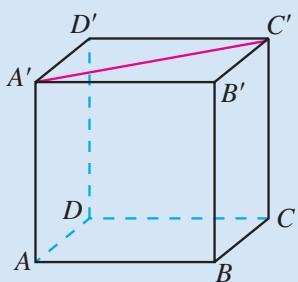
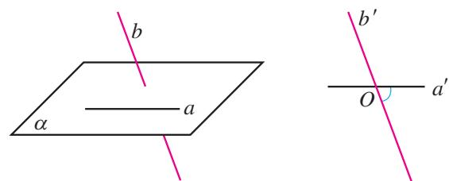

# 空间直线垂直与异面直线所成角

## 高中必修 第二册·人教A版数学

空间两条直线的位置关系有三种：平行直线、相交直线和异面直线。在初中我们已经研究了平行直线和相交直线。本节我们主要研究异面直线，首先研究如何刻画两条异面直线的位置关系。

观察

如图 8.6-1，在正方体 $ABCD-A'B'C'D'$ 中，直线 $A'C'$ 与直线 AB，直线 $A'D'$ 与直线 AB 都是异面直线，直线 $A'C'$ 与 $A'D'$ 相对于直线 AB 的位置相同吗？如果不同，如何表示这种差异呢？

  
图8.6-1

我们知道，平面内两条直线相交形成4个角，其中不大于 $90^{\circ}$ 的角称为这两条直线所成的角（或夹角），它刻画了一条直线相对于另一条直线倾斜的程度。类似地，我们也可以用“异面直线所成的角”来刻画两条异面直线的位置关系。

如图8.6-2，已知两条异面直线 $a$ ， $b$ ，经过空间任一点

  
图8.6-2

研究异面直线所成的角，就是通过平移把异面直线转化为相交直线。这是研究空间图形的一种基本思路，即把空间图形问题转化为平面图形问题。

O 分别作直线 $a' \parallel a$ ， $b' \parallel b$ ，我们把直线 $a'$ 与 $b'$ 所成的角叫做异面直线 a 与 b 所成的角（或夹角）.

如果两条异面直线所成的角是直角，那么我们就说这两条异面直线互相垂直．直线 a 与直线 b 垂直，记作 $a \perp b$ .

当两条直线 a, b 相互平行时，我们规定它们所成的角为 $0^{\circ}$ . 所以空间两条直线所成角 $\alpha$ 的取值范围是 $0^{\circ} \leqslant \alpha \leqslant 90^{\circ}$ .

直线 $a, b$ 所成角的大小与点 $O$ 的位置有关吗？
