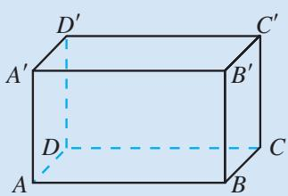
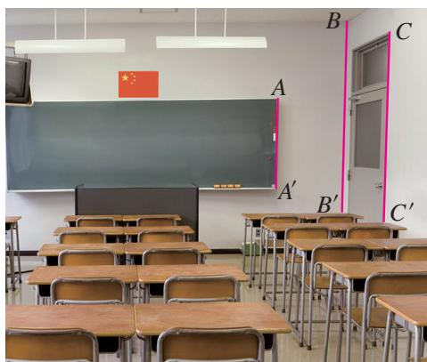
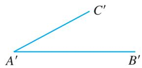
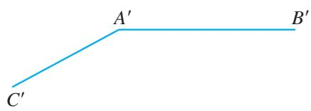
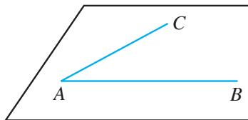
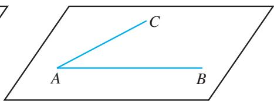
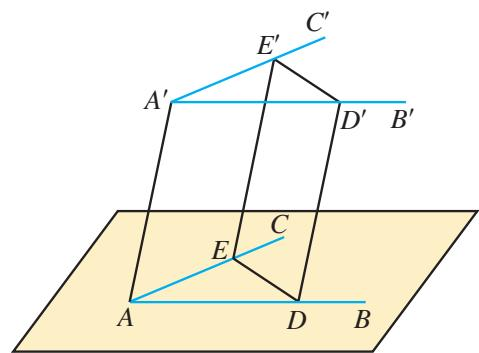

# 空间直线的平行关系与等角定理

## 高中必修 第二册·人教A版数学

观察

如图 8.5-1，在长方体 ABCD-A'B'C'D' 中，DC // AB，A'B' // AB。DC 与 A'B' 平行吗？

观察你所在的教室，你能找到类似的实例吗？

  
图8.5-1

可以发现， $DC \parallel A'B'$ . 再观察我们所在的教室（图8.5-2），黑板边所在直线 $AA'$ 和门框所在直线 $CC'$ 都平行于墙与墙的交线 $BB'$ ，那么 $CC' \parallel AA'$ . 这说明空间中的平行直线具有与平面内的平行直线类似的性质. 我们把它作为基本事实.

基本事实 4 平行于同一条直线的两条直线平行.

基本事实 4 表明，空间中平行于同一条直线的所有直线都互相平行。它给出了判断空间两条直线平行的依据。基本事实 4 表述的性质通常叫做平行线的传递性。

  
图8.5-2

思考

在平面内，如果一个角的两边与另一个角的两边分别对应平行，那么这两个角相等或互补。在空间中，这一结论是否仍然成立呢？

与平面中的情况类似，当空间中两个角的两条边分别对应平行时，这两个角有如图8.5-4所示的两种位置.

  
(1)

  
(2)  
图8.5-4

对于图 8.5-4(1)，我们可以构造两个全等三角形，使 $\angle BAC$ 和 $\angle B'A'C'$ 是它们的对应角，从而证明 $\angle BAC = \angle B'A'C'$ .

如图 8.5-5，分别在 $\angle BAC$ 和 $\angle B^{\prime}A^{\prime}C^{\prime}$ 的两边上截取 AD，AE 和 $A^{\prime}D^{\prime}$ ， $A^{\prime}E^{\prime}$ ，使得 $AD = A^{\prime}D^{\prime}$ ， $AE = A^{\prime}E^{\prime}$ 。连接 $AA^{\prime}$ ， $DD^{\prime}$ ， $EE^{\prime}$ ，DE， $D^{\prime}E^{\prime}$ 。

$$
\because A D \perp A ^ {\prime} D ^ {\prime},
$$

∴ 四边形 $ADD'A'$ 是平行四边形.

$$
\therefore A A ^ {\prime} \underline {{\perp}} D D ^ {\prime}.
$$

同理可证 $AA^{\prime} \perp EE^{\prime}$ .

$$
\therefore D D ^ {\prime} \underline {{\parallel}} E E ^ {\prime}.
$$

∴ 四边形 $DD^{\prime}E^{\prime}E$ 是平行四边形.

$$
\therefore D E = D ^ {\prime} E ^ {\prime}.
$$

$$
\therefore \triangle A D E \cong \triangle A ^ {\prime} D ^ {\prime} E ^ {\prime}.
$$

  
图8.5-5

$$
\therefore \angle B A C = \angle B ^ {\prime} A ^ {\prime} C ^ {\prime}.
$$

对于图 8.5-4(2) 的情形，请同学们自己给出证明.

这样，我们就得到了下面的定理：

定理 如果空间中两个角的两条边分别对应平行，那么这两个角相等或互补.

## 本节例题与练习

- [例 1 如图 8.5-3](../%E4%B9%A0%E9%A2%98/Q070000000719.md)
- [练习 1](../%E4%B9%A0%E9%A2%98/Q070000000720.md)
- [练习 2](../%E4%B9%A0%E9%A2%98/Q070000000721.md)
- [练习 3](../%E4%B9%A0%E9%A2%98/Q070000000722.md)
- [练习 4](../%E4%B9%A0%E9%A2%98/Q070000000723.md)

## 所属组织

- [8.5.1 直线与直线平行](../%E7%9F%A5%E8%AF%86%E4%B8%B2%E8%81%94/%E4%BA%BA%E6%95%99A-%E5%BF%85%E4%BF%AE%E7%AC%AC%E4%BA%8C%E5%86%8C/%E7%AC%AC%E5%85%AB%E7%AB%A0%20%E7%AB%8B%E4%BD%93%E5%87%A0%E4%BD%95%E5%88%9D%E6%AD%A5/8.5%20%E7%A9%BA%E9%97%B4%E7%9B%B4%E7%BA%BF%E3%80%81%E5%B9%B3%E9%9D%A2%E7%9A%84%E5%B9%B3%E8%A1%8C/8.5.1%20%E7%9B%B4%E7%BA%BF%E4%B8%8E%E7%9B%B4%E7%BA%BF%E5%B9%B3%E8%A1%8C.md)

## 相关练习组织（范围关联）

- [8.5.1 直线与直线平行](../%E9%A2%98%E5%9E%8B/%E6%8C%89%E7%AB%A0%E8%8A%82%E5%88%86%E7%B1%BB/%E4%BA%BA%E6%95%99A-%E5%BF%85%E4%BF%AE%E7%AC%AC%E4%BA%8C%E5%86%8C/%E7%AC%AC%E5%85%AB%E7%AB%A0%20%E7%AB%8B%E4%BD%93%E5%87%A0%E4%BD%95%E5%88%9D%E6%AD%A5/8.5%20%E7%A9%BA%E9%97%B4%E7%9B%B4%E7%BA%BF%E3%80%81%E5%B9%B3%E9%9D%A2%E7%9A%84%E5%B9%B3%E8%A1%8C.md)
