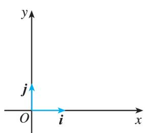
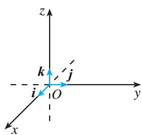
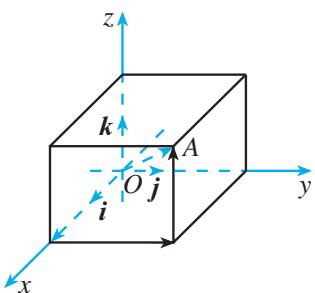
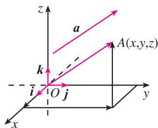

我们知道，平面直角坐标系由平面内两条互相垂直、原点重合的数轴组成。利用单位正交基底概念，我们还可以这样理解平面直角坐标系：如图1.3-1，在平面内选定一点 $O$ 和一个单位正交基底 $\{i, j\}$ ，以 $O$ 为原点，分别以 $i, j$ 的方向为正方向、以它们的长为单位长度建立两条数轴： $x$ 轴、 $y$ 轴，那么我们就建立了一个平面直角坐标系。

  
图1.3-1

类似地，在空间选定一点 O 和一个单位正交基底 $\{i, j, k\}$ （图 1.3-2）。以点 O 为原点，分别以 i, j, k 的方向为正方向、以它们的长为单位长度建立三条数轴：x 轴、y 轴、z 轴，它们都叫做坐标轴。这时我们就建立了一个空间直角坐标系 Oxyz，O 叫做原点，i, j, k 都叫做坐标向量，通过每两条坐标轴的平面叫做坐标平面，分别称为 Oxy 平面，Oyz 平面，Ozx 平面，它们把空间分成八个部分。

画空间直角坐标系 Oxyz 时，一般使 $\angle xOy = 135^{\circ}$ （或 $45^{\circ}$ ）， $\angle yOz = 90^{\circ}$ .

  
图1.3-2

在空间直角坐标系中，让右手拇指指向 x 轴的正方向，食指指向 $y$ 轴的正方向，如果中指指向 $z$ 轴的正方向，则称这个坐标系为右手直角坐标系。本书建立的坐标系都是右手直角坐标系。

在平面直角坐标系中，每一个点和向量都可用一对有序实数（即它的坐标）表示；类似地，在空间直角坐标系中，每一个点和向量也可以用有序实数组来表示。

在空间直角坐标系 Oxyz 中（图 1.3-3），i，j，k 为坐标向量，对空间任意一点 A，对应一个向量 $\overrightarrow{OA}$ ，且点 A 的位置由向量 $\overrightarrow{OA}$ 唯一确定，由空间向量基本定理，存在唯一的有序实数组 $(x, y, z)$ ，使

$$
\overrightarrow {O A} = x \mathbf {i} + y \mathbf {j} + z \mathbf {k}.
$$

在单位正交基底 $\{i, j, k\}$ 下与向量 $\overrightarrow{OA}$ 对应的有序实数组 $(x, y, z)$ ，叫做点 A 在空间直角坐标系中的坐标，记作 $A(x, y, z)$ ，其中 x 叫做点 A 的横坐标，y 叫做点 A 的纵坐标，z 叫做点 A 的竖坐标.

  
图1.3-3

  
图1.3-4

在空间直角坐标系 Oxyz 中，给定向量 a，作 $\overrightarrow{OA}=a$ （图 1.3-4）。由空间向量基本定理，存在唯一的有序实数组 $(x, y, z)$ ，使

$$
\boldsymbol {a} = x \boldsymbol {i} + y \boldsymbol {j} + z \boldsymbol {k}.
$$

有序实数组 $(x, y, z)$ 叫做 a 在空间直角坐标系 Oxyz 中的坐标，上式可简记作

$$
\boldsymbol {a} = (x, y, z).
$$

符号 $(x, y, z)$ 具有双重意义，它既可以表示向量，也可以表示点，在表述时要注意区分.

这样，在空间直角坐标系中，空间中的点和向量都可以用三个有序实数表示.

在空间直角坐标系 $Oxyz$ 中，对空间任意一点 $A$ 或向量 $\overrightarrow{OA}$ ，还可以借助几何直观确定它们的坐标 $(x, y, z)$ 。如图1.3-5，过点 $A$ 分别作垂直于 $x$ 轴、 $y$ 轴和 $z$ 轴的平面，依次交 $x$ 轴、 $y$ 轴和 $z$ 轴于点 $B$ ， $C$ 和 $D$ 。可以证明 $\overrightarrow{OA}$ 在 $x$ 轴、 $y$ 轴、 $z$ 轴上的投影向量分别为 $\overrightarrow{OB}$ ， $\overrightarrow{OC}$ ， $\overrightarrow{OD}$ ，且 $\overrightarrow{OA} = \overrightarrow{OB} + \overrightarrow{OC} + \overrightarrow{OD}$ 。设点 $B$ ， $C$ 和 $D$ 在 $x$ 轴、 $y$ 轴和 $z$ 轴上的坐标分别是 $x$ ， $y$ 和 $z$ ，那么点 $A$ （向量 $\overrightarrow{OA}$ ）的坐标为 $(x, y, z)$ 。
