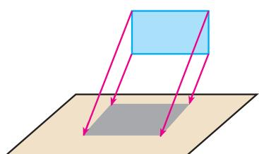
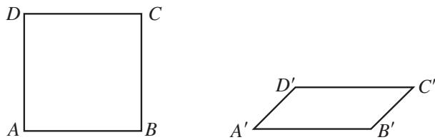

在初中，我们已经学习过投影。一个物体的投影，不仅与这个物体的形状有关，而且还与投影的方式和物体与投影面的位置关系有关。如果一个矩形垂直于投影面，投影线不垂直于投影面，则矩形的平行投影是一个平行四边形（图8.2-2）。

  
图8.2-2

利用平行投影，人们获得了画直观图的斜二测画法。利用这种画法画水平放置的平面图形的直观图，其步骤是：

（1）在已知图形中取互相垂直的 $x$ 轴和 $y$ 轴，两轴相交于点 $O$ 。画直观图时，把它们画成对应的 $x'$ 轴与 $y'$ 轴，两轴相交于点 $O'$ ，且使 $\angle x'O'y'=45^{\circ}$ （或 $135^{\circ}$ ），它们确定的平面表示水平面.

（2）已知图形中平行于 $x$ 轴或 $y$ 轴的线段，在直观图中分别画成平行于 $x'$ 轴或 $y'$ 轴的线段.

（3）已知图形中平行于 $x$ 轴的线段，在直观图中保持原长度不变，平行于 $y$ 轴的线段，在直观图中长度为原来的一半.

对于平面多边形，我们常用斜二测画法画它们的直观图．如图8.2-3， $\square A'B'C'D'$ 就是利用斜二测画法画出的水平放置的正方形ABCD的直观图．其中横向线段 $A'B' = AB$ ， $C'D' = CD$ ；纵向线段 $A'D' = \frac{1}{2} AD$ ， $B'C' = \frac{1}{2} BC$ ； $\angle D'A'B' = 45^\circ$ ．这与我们的直观观察是一致的.

  
图8.2-3
