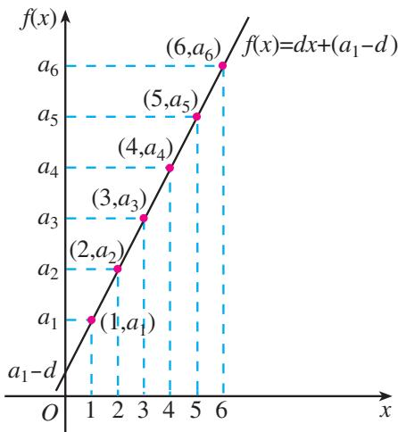

# 等差数列与一次函数

## 高中选择性必修 第二册·人教A版数学

由于 $a_{n}=a_{1}+(n-1)d=dn+(a_{1}-d)$ ，所以当 $d\neq0$ 时，等差数列 $\{a_{n}\}$ 的第 n 项 $a_{n}$ 是一次函数 $f(x)=dx+(a_{1}-d)(x\in\mathbf{R})$ 当 x=n 时的函数值，即 $a_{n}=f(n)$ .

在平面直角坐标系中画出函数 $f(x)=dx+(a_{1}-d)$ 的图象，就得到一条斜率为 d，截距为 $a_{1}-d$ 的直线。在这条直线上描出点 $(1, f(1)), (2, f(2)), \cdots, (n, f(n)), \cdots$ ，就得到了等差数列 $\{a_{n}\}$ 的图象。事实上，公差 $d \neq 0$ 的等差数列 $\{a_{n}\}$ 的图象是点 $(n, a_{n})$ 组成的集合，这些点均匀分布在直线 $f(x)=dx+(a_{1}-d)$ 上。d > 0, $a_{1}-d > 0$ 的情形如图 4.2-1 所示。

  
图4.2-1

反之，任给一次函数 $f(x)=kx+b$ （k，b 为常数），则 $f(1)=k+b$ ， $f(2)=2k+b$ ，…， $f(n)=nk+b$ ，…构成一个等差数列 $\{nk+b\}$ ，其首项为 $(k+b)$ ，公差为 k.
