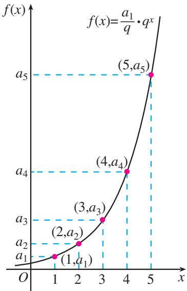

# 等比数列与指数函数

## 高中选择性必修 第二册·人教A版数学

类似于等差数列与一次函数的关系，由 $a_{n} = \frac{a_{1}}{q}\cdot q^{n}$ 可知，当 $q > 0$ 且 $q\neq 1$ 时，等比数列 $\{a_n\}$ 的第 $n$ 项 $a_{n}$ 是函数 $f(x) = \frac{a_1}{q}\cdot q^x (x\in \mathbf{R})$ 当 $x = n$ 时的函数值，即 $a_{n} = f(n)$ $a_1 > 0$ ， $q > 1$ 的情形如图4.3-1所示.

  
图4.3-1

类比指数函数的性质，说说公比 q > 0 的等比数列的单调性.

公比 $q > 0$ 且 $q \neq 1$ 的等比数列 $\{a_{n}\}$ 的图象有什么特点？

反之，任给函数 $f(x)=ka^{x}(k,a$ 为常数， $k\neq0,a>0$ ，且 $a\neq1)$ ，则 $f(1)=ka$ ， $f(2)=ka^{2},\cdots,f(n)=ka^{n},\cdots$ 构成一个等比数列 $\{ka^{n}\}$ ，其首项为 ka，公比为 a.

下面，我们利用通项公式解决等比数列的一些问题.
