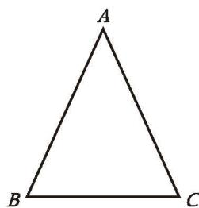

# 等腰三角形“等角对等边”判定定理

## 北师大版初中数学·八年级下册

前面已经证明了等腰三角形的两个底角相等。反过来，有两个角相等的三角形是等腰三角形吗？

可以发现：有两个角相等的三角形是等腰三角形。如何证明这一结论呢？

图1-18

如图 1-18, 在 $\triangle ABC$ 中, $\angle B = \angle C$ , 要想证明 $AB = AC$ , 只要能构造两个全等的三角形, 使 $AB$ 与 $AC$ 成为对应边就可以了。

请你写出证明过程。

这一定理可以简述为：等角对等边。
