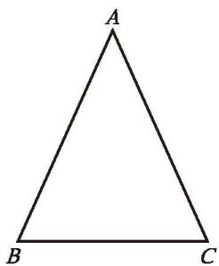
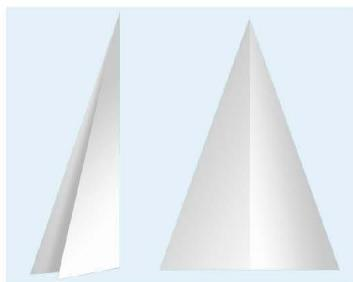
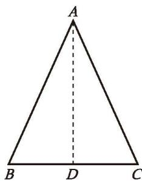

定理 等腰三角形的两个底角相等。

这一定理可以简述为：等边对等角。

已知：如图 1-15，在 $\triangle ABC$ 中，AB = AC。

求证： $\angle B=\angle C$ 。

分析：有哪些结论可以证明两个角相等？如图 1-16，还记得利用折纸的方法探索等腰三角形的性质吗？这对你有什么启发？

图1-15

图1-16

图1-17

证明：如图1-17，取 $BC$ 的中点 $D$ ，连接 $AD$ 。 $\because AB = AC, BD = CD, AD = AD,$ $\therefore \triangle ABD \cong \triangle ACD (\mathrm{SSS})$ 。 $\therefore \angle B = \angle C$ （全等三角形的对应角相等）。

还有其他证法吗？
