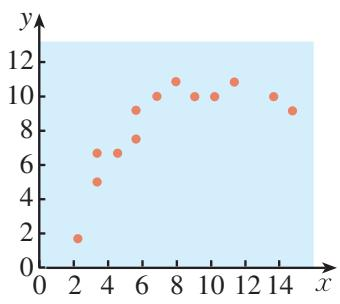
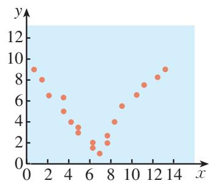
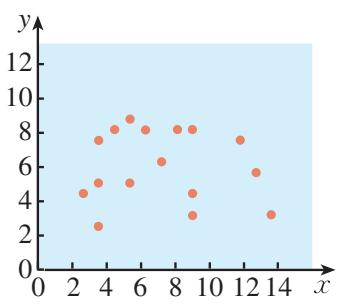

# 线性相关与非线性相关

## 高中选择性必修 第三册·人教A版数学

思考

（1）两个变量负相关时，成对样本数据的散点图有什么特点？

（2）你能举出生活中两个变量正相关或负相关的一些例子吗？

散点图是描述成对数据之间关系的一种直观方法。观察散点图8.1-1，从中我们不仅可以大致看出脂肪含量和年龄呈现正相关，而且从整体上可以看出散点落在某条直线附近。一般地，如果两个变量的取值呈现正相关或负相关，而且散点落在一条直线附近，我们就称这两个变量线性相关。

观察散点图8.1-2，我们发现：图（1）中的散点落在某条曲线附近，而不是落在一条直线附近，说明这两个变量具有相关性，但不是线性相关；类似地，图（2）中的散点落在一条折线附近，这两个变量也具有相关性，但它们既不是正相关，也不是负相关；图（3）中的散点杂乱无章，无规律可言，看不出这两个变量有什么相关性.

  
(1)

  
(2)

  
(3)  
图8.1-2

一般地，如果两个变量具有相关性，但不是线性相关，那么我们就称这两个变量非线性相关或曲线相关.
