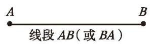
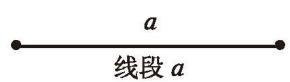
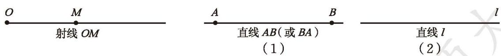

# 线段、射线、直线的字母表示方法

## 情境引入与思考

## 知识讲解

### 北师大版初中数学·七年级上册

如图 4-3、图 4-4、图 4-5，我们可以用以下方式分别表示线段、射线、直线：

(1)

图4-3

图4-4

图4-5

## 本节例题与练习

- [随堂练习 4.1.1-1](../%E4%B9%A0%E9%A2%98/Q070000002163.md)
- [随堂练习 4.1.1-2](../%E4%B9%A0%E9%A2%98/Q070000002164.md)

## 所属组织

- [4.1.1 线段、射线、直线的概念与“两点确定一条直线”](../%E7%9F%A5%E8%AF%86%E4%B8%B2%E8%81%94/%E5%8C%97%E5%B8%88%E5%A4%A7-%E4%B8%83%E5%B9%B4%E7%BA%A7%E4%B8%8A%E5%86%8C/%E7%AC%AC%E5%9B%9B%E7%AB%A0%20%E5%9F%BA%E6%9C%AC%E5%B9%B3%E9%9D%A2%E5%9B%BE%E5%BD%A2/1%20%E7%BA%BF%E6%AE%B5%E3%80%81%E5%B0%84%E7%BA%BF%E3%80%81%E7%9B%B4%E7%BA%BF/4.1.1%20%E7%BA%BF%E6%AE%B5%E3%80%81%E5%B0%84%E7%BA%BF%E3%80%81%E7%9B%B4%E7%BA%BF%E7%9A%84%E6%A6%82%E5%BF%B5%E4%B8%8E%E2%80%9C%E4%B8%A4%E7%82%B9%E7%A1%AE%E5%AE%9A%E4%B8%80%E6%9D%A1%E7%9B%B4%E7%BA%BF%E2%80%9D.md)

## 相关练习组织（范围关联）

- [4.1.1 线段、射线、直线的概念与“两点确定一条直线”](../%E9%A2%98%E5%9E%8B/%E6%8C%89%E7%AB%A0%E8%8A%82%E5%88%86%E7%B1%BB/%E5%8C%97%E5%B8%88%E5%A4%A7-%E4%B8%83%E5%B9%B4%E7%BA%A7%E4%B8%8A%E5%86%8C/%E7%AC%AC%E5%9B%9B%E7%AB%A0%20%E5%9F%BA%E6%9C%AC%E5%B9%B3%E9%9D%A2%E5%9B%BE%E5%BD%A2/%E7%BA%BF%E6%AE%B5%E3%80%81%E5%B0%84%E7%BA%BF%E3%80%81%E7%9B%B4%E7%BA%BF.md)
