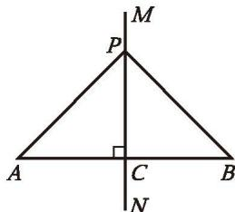

# 线段垂直平分线的性质定理及证明

## 情境引入与思考

## 知识讲解

### 北师大版初中数学·八年级下册

已知：如图 1-29，直线 $MN \perp AB$ ，垂足为 C，且 AC = BC，P 是 MN 上的任意一点。

求证： $PA = PB$ 。

证明：∵ $MN \perp AB,$

$$
\therefore \angle P C A = \angle P C B = 90 ^ {\circ} 。
$$

$$
\because A C = B C, P C = P C,
$$

图1-29

$$
\therefore \quad \triangle P C A \cong \triangle P C B (\mathrm{SAS}) _ {\circ}
$$

如果点 $P$ 与点 $C$ 重合, 那么结论显然成立。

∴ PA = PB（全等三角形的对应边相等）。

定理 线段垂直平分线上的点到这条线段两个端点的距离相等。

## 本节例题与练习

- [1.4 随堂练习第1题](../%E4%B9%A0%E9%A2%98/Q070000002848.md)
- [1.4 随堂练习第2题](../%E4%B9%A0%E9%A2%98/Q070000002849.md)
- [例1 利用线段垂直平分线判定定理证明直线垂直平分线段](../%E4%B9%A0%E9%A2%98/Q070000002847.md)

## 所属组织

- [线段垂直平分线的性质与判定](../%E7%9F%A5%E8%AF%86%E4%B8%B2%E8%81%94/%E5%8C%97%E5%B8%88%E5%A4%A7-%E5%85%AB%E5%B9%B4%E7%BA%A7%E4%B8%8B%E5%86%8C/%E7%AC%AC%E4%B8%80%E7%AB%A0%20%E4%B8%89%E8%A7%92%E5%BD%A2%E7%9A%84%E8%AF%81%E6%98%8E%E5%8F%8A%E5%85%B6%E5%BA%94%E7%94%A8/4%20%E7%BA%BF%E6%AE%B5%E7%9A%84%E5%9E%82%E7%9B%B4%E5%B9%B3%E5%88%86%E7%BA%BF/%E7%BA%BF%E6%AE%B5%E5%9E%82%E7%9B%B4%E5%B9%B3%E5%88%86%E7%BA%BF%E7%9A%84%E6%80%A7%E8%B4%A8%E4%B8%8E%E5%88%A4%E5%AE%9A.md)

## 相关练习组织（范围关联）

- [线段垂直平分线的性质与判定](../%E9%A2%98%E5%9E%8B/%E6%8C%89%E7%AB%A0%E8%8A%82%E5%88%86%E7%B1%BB/%E5%8C%97%E5%B8%88%E5%A4%A7-%E5%85%AB%E5%B9%B4%E7%BA%A7%E4%B8%8B%E5%86%8C/%E7%AC%AC%E4%B8%80%E7%AB%A0%20%E4%B8%89%E8%A7%92%E5%BD%A2%E7%9A%84%E8%AF%81%E6%98%8E%E5%8F%8A%E5%85%B6%E5%BA%94%E7%94%A8/%E7%BA%BF%E6%AE%B5%E7%9A%84%E5%9E%82%E7%9B%B4%E5%B9%B3%E5%88%86%E7%BA%BF.md)
