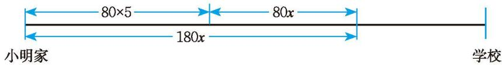

# 行程追及问题与画线段图分析等量关系

## 情境引入与思考

## 知识讲解

### 北师大版初中数学·七年级上册

小明家与他就读的学校相距 1000 m。一天，小明以 80 m/min 的速度出发，出发后 5 min，小明的爸爸发现小明忘了带语文书。于是，爸爸立即以 180 m/min 的速度沿同一条路去追小明，并且在途中追上了他。爸爸追上小明用了多长时间？追上小明时，距离学校还有多远？

(1) 问题中有哪些已知量和未知量?

(2) 想象一下追及的过程, 你能用一个图直观表示问题中各个量之间的关系吗?

(3) 你是怎样列出方程的？与同伴进行交流。

设爸爸追上小明用了 $x \min$ 。当爸爸追上小明时，两人所行路程相等，如图5-3所示。

图5-3

画图分析数量关系是一种有效方法。

根据等量关系，可列出方程：\_\_\_\_。

解这个方程，得 x=\_\_\_\_。

因此，爸爸追上小明用了\_\_\_\_min，此时距离学校还有\_\_\_\_m。

根据相等量的两种不同表达式就可以建立等量关系，列出方程了。

## 本节例题与练习

- [例3 环形跑道上的追及与相遇问题](../%E4%B9%A0%E9%A2%98/Q070000002245.md)
- [随堂练习 5.3.3-1](../%E4%B9%A0%E9%A2%98/Q070000002246.md)

## 所属组织

- [5.3.3 行程追及相遇问题与列方程解应用题一般步骤](../%E7%9F%A5%E8%AF%86%E4%B8%B2%E8%81%94/%E5%8C%97%E5%B8%88%E5%A4%A7-%E4%B8%83%E5%B9%B4%E7%BA%A7%E4%B8%8A%E5%86%8C/%E7%AC%AC%E4%BA%94%E7%AB%A0%20%E4%B8%80%E5%85%83%E4%B8%80%E6%AC%A1%E6%96%B9%E7%A8%8B/3%20%E4%B8%80%E5%85%83%E4%B8%80%E6%AC%A1%E6%96%B9%E7%A8%8B%E7%9A%84%E5%BA%94%E7%94%A8/5.3.3%20%E8%A1%8C%E7%A8%8B%E8%BF%BD%E5%8F%8A%E7%9B%B8%E9%81%87%E9%97%AE%E9%A2%98%E4%B8%8E%E5%88%97%E6%96%B9%E7%A8%8B%E8%A7%A3%E5%BA%94%E7%94%A8%E9%A2%98%E4%B8%80%E8%88%AC%E6%AD%A5%E9%AA%A4.md)

## 相关练习组织（范围关联）

- [5.3.3 行程追及相遇问题与列方程解应用题一般步骤](../%E9%A2%98%E5%9E%8B/%E6%8C%89%E7%AB%A0%E8%8A%82%E5%88%86%E7%B1%BB/%E5%8C%97%E5%B8%88%E5%A4%A7-%E4%B8%83%E5%B9%B4%E7%BA%A7%E4%B8%8A%E5%86%8C/%E7%AC%AC%E4%BA%94%E7%AB%A0%20%E4%B8%80%E5%85%83%E4%B8%80%E6%AC%A1%E6%96%B9%E7%A8%8B/%E4%B8%80%E5%85%83%E4%B8%80%E6%AC%A1%E6%96%B9%E7%A8%8B%E7%9A%84%E5%BA%94%E7%94%A8.md)
