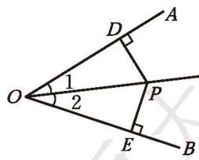

# 角平分线的判定定理及证明

## 北师大版初中数学·八年级下册

已知：如图 1-36，点 P 为 $\angle AOB$ 内一点， $PD \perp OA$ ， $PE \perp OB$ ，垂足分别为 D，E，且 PD = PE。

求证：OP平分∠AOB。

证明：∵ $PD \perp OA$ ， $PE \perp OB$ ，垂足分别为 D，E，
∴ $\angle ODP = \angle OEP = 90^{\circ}$ ∵ PD = PE, OP = OP,
∴ Rt△DOP≌Rt△EOP(HL)。

图1-36

∴ $\angle1=\angle2$ （全等三角形的对应角相等）。

∴ OP 平分 $\angle AOB$ 。

定理 在一个角的内部，到角的两边距离相等的点在这个角的平分线上。
