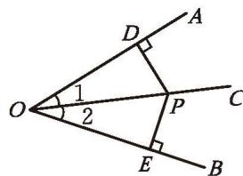

# 角平分线的性质定理及证明

## 情境引入与思考

## 知识讲解

### 北师大版初中数学·八年级下册

已知：如图 1-35，OC 是 $\angle AOB$ 的平分线，点 P 在 OC 上， $PD \perp OA$ ， $PE \perp OB$ ，垂足分别为 D，E。

求证： ${PD} = {PE}$ 。

证明：∵ $PD \perp OA$ ， $PE \perp OB$ ，垂足分别为 D，E，
∴ $\angle PDO = \angle PEO = 90^{\circ}$ ∵ $\angle 1 = \angle 2, OP = OP,$ ∴ $\triangle PDO \cong \triangle PEO (AAS)$ 。

图1-35

∴ PD = PE（全等三角形的对应边相等）。

定理 角平分线上的点到这个角的两边的距离相等。

## 本节例题与练习

- [1.5 随堂练习第1题](../%E4%B9%A0%E9%A2%98/Q070000002861.md)
- [例1 利用角平分线判定与30°直角三角形性质求线段长](../%E4%B9%A0%E9%A2%98/Q070000002860.md)

## 所属组织

- [角平分线的性质与判定](../%E7%9F%A5%E8%AF%86%E4%B8%B2%E8%81%94/%E5%8C%97%E5%B8%88%E5%A4%A7-%E5%85%AB%E5%B9%B4%E7%BA%A7%E4%B8%8B%E5%86%8C/%E7%AC%AC%E4%B8%80%E7%AB%A0%20%E4%B8%89%E8%A7%92%E5%BD%A2%E7%9A%84%E8%AF%81%E6%98%8E%E5%8F%8A%E5%85%B6%E5%BA%94%E7%94%A8/5%20%E8%A7%92%E5%B9%B3%E5%88%86%E7%BA%BF/%E8%A7%92%E5%B9%B3%E5%88%86%E7%BA%BF%E7%9A%84%E6%80%A7%E8%B4%A8%E4%B8%8E%E5%88%A4%E5%AE%9A.md)

## 相关练习组织（范围关联）

- [角平分线的性质与判定](../%E9%A2%98%E5%9E%8B/%E6%8C%89%E7%AB%A0%E8%8A%82%E5%88%86%E7%B1%BB/%E5%8C%97%E5%B8%88%E5%A4%A7-%E5%85%AB%E5%B9%B4%E7%BA%A7%E4%B8%8B%E5%86%8C/%E7%AC%AC%E4%B8%80%E7%AB%A0%20%E4%B8%89%E8%A7%92%E5%BD%A2%E7%9A%84%E8%AF%81%E6%98%8E%E5%8F%8A%E5%85%B6%E5%BA%94%E7%94%A8/%E8%A7%92%E5%B9%B3%E5%88%86%E7%BA%BF.md)
