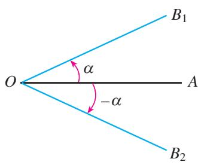
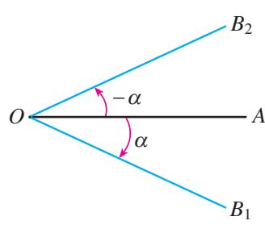

# 角的加减与相反角

## 知识讲解

设 $\alpha, \beta$ 是任意两个角. 我们规定, 把角 $\alpha$ 的终边旋转角 $\beta$ , 这时终边所对应的角是 $\alpha + \beta$ .

类似于实数 $a$ 的相反数是 $-a$ ，我们引入任意角 $\alpha$ 的相反角的概念。如图5.1-4，我们把射线 $OA$ 绕端点 $O$ 按不同方向旋转相同的量所成的两个角叫做互为相反角。角 $\alpha$ 的相反角记为 $-\alpha$ 。于是，像实数减法的“减去一个数等于加上这个数的相反数”一样，我们有

$$
\alpha - \beta = \alpha + (- \beta).
$$

这样，角的减法可以转化为角的加法.

  
(1)

  
图5.1-4  
(2)

## 后续知识

- [弧度制](%E5%BC%A7%E5%BA%A6%E5%88%B6--000060.md)
- [终边相同的角](%E7%BB%88%E8%BE%B9%E7%9B%B8%E5%90%8C%E7%9A%84%E8%A7%92--000059.md)

## 本节例题与练习

- [5.1.1 任意角·课堂练习](../%E4%B9%A0%E9%A2%98/Q3589849757165866265.md)
- [例 1 在 $0^{\circ} \s](../%E4%B9%A0%E9%A2%98/Q17971824961807289772.md)
- [例 2 写出终边在 y 轴上的角的集合](../%E4%B9%A0%E9%A2%98/Q12487925528325164311.md)
- [例 3 写出终边在直线 y=x 上的角](../%E4%B9%A0%E9%A2%98/Q2523082307250497600.md)
- [练习 3](../%E4%B9%A0%E9%A2%98/Q3200230648978077214.md)
- [练习 4](../%E4%B9%A0%E9%A2%98/Q6729676678243699124.md)
- [练习 5](../%E4%B9%A0%E9%A2%98/Q15464064183587572741.md)

## 所属组织

- [5.1.1 任意角](../%E7%9F%A5%E8%AF%86%E4%B8%B2%E8%81%94/%E4%BA%BA%E6%95%99A-%E5%BF%85%E4%BF%AE%E7%AC%AC%E4%B8%80%E5%86%8C/%E7%AC%AC%E4%BA%94%E7%AB%A0%20%E4%B8%89%E8%A7%92%E5%87%BD%E6%95%B0/5.1%20%E4%BB%BB%E6%84%8F%E8%A7%92%E5%92%8C%E5%BC%A7%E5%BA%A6%E5%88%B6/5.1.1%20%E4%BB%BB%E6%84%8F%E8%A7%92.md)

## 相关练习组织（范围关联）

- [5.1.1 任意角](../%E9%A2%98%E5%9E%8B/%E4%BA%BA%E6%95%99A-%E5%BF%85%E4%BF%AE%E7%AC%AC%E4%B8%80%E5%86%8C/%E7%AC%AC%E4%BA%94%E7%AB%A0%20%E4%B8%89%E8%A7%92%E5%87%BD%E6%95%B0/5.1%20%E4%BB%BB%E6%84%8F%E8%A7%92%E5%92%8C%E5%BC%A7%E5%BA%A6%E5%88%B6/5.1.1%20%E4%BB%BB%E6%84%8F%E8%A7%92.md)
