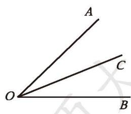

# 角的平分线概念及数量关系

## 情境引入与思考

## 知识讲解

### 北师大版初中数学·七年级上册

从一个角的顶点引出的一条射线，把这个角分成两个相等的角，这条射线叫作这个角的平分线（angle bisector）。

如图 4-26，射线 OC 是 $\angle AOB$ 的平分线。这时， $\angle AOC = \angle BOC = \frac{1}{2} \angle AOB$ （或 $\angle AOB = 2 \angle AOC = 2 \angle BOC$ ）。

图4-26

## 本节例题与练习

- [随堂练习 4.2.2-1](../%E4%B9%A0%E9%A2%98/Q070000002179.md)
- [随堂练习 4.2.2-2](../%E4%B9%A0%E9%A2%98/Q070000002180.md)

## 所属组织

- [4.2.2 角的比较与角平分线](../%E7%9F%A5%E8%AF%86%E4%B8%B2%E8%81%94/%E5%8C%97%E5%B8%88%E5%A4%A7-%E4%B8%83%E5%B9%B4%E7%BA%A7%E4%B8%8A%E5%86%8C/%E7%AC%AC%E5%9B%9B%E7%AB%A0%20%E5%9F%BA%E6%9C%AC%E5%B9%B3%E9%9D%A2%E5%9B%BE%E5%BD%A2/2%20%E8%A7%92/4.2.2%20%E8%A7%92%E7%9A%84%E6%AF%94%E8%BE%83%E4%B8%8E%E8%A7%92%E5%B9%B3%E5%88%86%E7%BA%BF.md)

## 相关练习组织（范围关联）

- [4.2.2 角的比较与角平分线](../%E9%A2%98%E5%9E%8B/%E6%8C%89%E7%AB%A0%E8%8A%82%E5%88%86%E7%B1%BB/%E5%8C%97%E5%B8%88%E5%A4%A7-%E4%B8%83%E5%B9%B4%E7%BA%A7%E4%B8%8A%E5%86%8C/%E7%AC%AC%E5%9B%9B%E7%AB%A0%20%E5%9F%BA%E6%9C%AC%E5%B9%B3%E9%9D%A2%E5%9B%BE%E5%BD%A2/%E8%A7%92.md)
