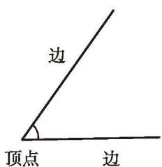
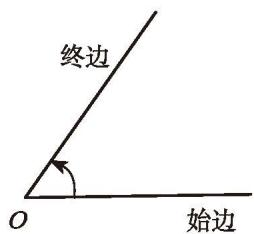
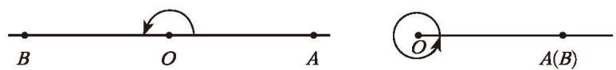
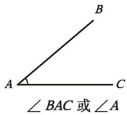
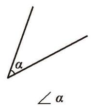
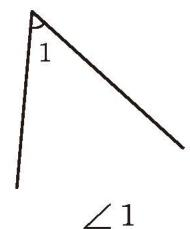

角（angle）由两条具有公共端点的射线组成（如图4-17）。角也可以看成是由一条射线绕着它的端点旋转而成的（如图4-18）。

图4-17

图4-18

角的大小与边的长短无关。

如图 4-19, 一条射线绕它的端点旋转, 当终边和始边成一条直线时, 所成的角叫作平角 (straight angle)。终边继续旋转, 当它又和始边重合时, 所成的角叫作周角 (round angle)。

图4-19

(2)

(3)

如图 4-20，通常可以用以下方式表示角：

(1)

图4-20

