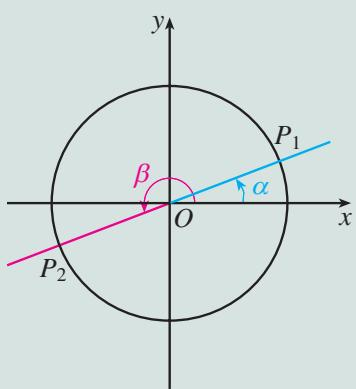
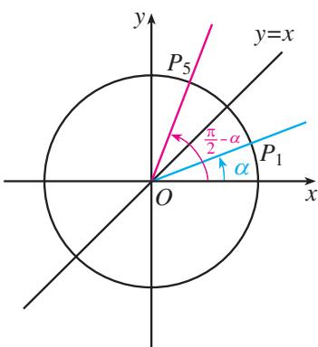

# 诱导公式五与公式六

## 知识讲解

如图 5.3-1，在直角坐标系内，设任意角 $\alpha$ 的终边与单位圆交于点 $P_{1}$ .

  
图5.3-1

设 $P_{1}(x_{1},y_{1})$ ，

作 $P_{1}$ 关于直线 $y = x$ 的对称点 $P_{5}$ ，以 $OP_{5}$ 为终边的角 $\gamma$ 与角 $\alpha$ 有什么关系？角 $\gamma$ 与角 $\alpha$ 的三角函数值之间有什么关系？

如图5.3-5，以 $OP_{5}$ 为终边的角 $\gamma$ 都是与角 $\frac{\pi}{2} -\alpha$ 终边相同的角，即 $\gamma = 2k\pi +\left(\frac{\pi}{2} -\alpha\right)$ $(k\in \mathbf{Z})$ ，因此，只要探究角 $\frac{\pi}{2} -\alpha$ 与 $\alpha$ 的三角函数值之间的关系即可.

设 $P_{5}(x_{5},y_{5})$ ，由于 $P_{5}$ 是点 $P_{1}$ 关于直线 $y = x$ 的对称点，可以证明

$$
x _ {5} = y _ {1}, \quad y _ {5} = x _ {1}.\tag{①}
$$

根据三角函数的定义，得

$$
\sin \left(\frac {\pi}{2} - \alpha\right) = y _ {5}, \cos \left(\frac {\pi}{2} - \alpha\right) = x _ {5}.
$$

从而得

公式五

图5.3-5

$$
\sin \left(\frac {\pi}{2} - \alpha\right) = \cos \alpha ,
$$

$$
\cos \left(\frac {\pi}{2} - \alpha\right) = \sin \alpha .
$$

?

你能利用平面几何的知识，就图5.3-5所示的情况证明①式吗？其他情况呢？

作 $P_{5}$ 关于 $y$ 轴的对称点，又能得到什么结论？

类似地，可得

公式六

$$
\sin \left(\frac {\pi}{2} + \alpha\right) = \cos \alpha ,
$$

$$
\cos \left(\frac {\pi}{2} + \alpha\right) = - \sin \alpha .
$$

角 $\frac{\pi}{2} + \alpha$ 的终边与角 $\alpha$ 的终边具有怎样的对称性？据此你将如何证明公式六？

利用公式五或公式六，可以实现正弦函数与余弦函数的相互转化.

公式一～公式六都叫做诱导公式.

## 本节例题与练习

- [三角函数值填表练习](../%E4%B9%A0%E9%A2%98/Q3148391431592193301.md)
- [习题5.3 复习巩固 第1题](../%E4%B9%A0%E9%A2%98/Q3147339461026427893.md)
- [习题5.3 复习巩固 第2题](../%E4%B9%A0%E9%A2%98/Q6506397566875381647.md)
- [习题5.3 复习巩固 第3题](../%E4%B9%A0%E9%A2%98/Q1098641406394757254.md)
- [习题5.3 复习巩固 第4题](../%E4%B9%A0%E9%A2%98/Q9146492403903859849.md)
- [习题5.3 拓广探索 第10题](../%E4%B9%A0%E9%A2%98/Q2955636846879002861.md)
- [习题5.3 拓广探索 第9题](../%E4%B9%A0%E9%A2%98/Q13059948330241989265.md)
- [习题5.3 综合运用 第5题](../%E4%B9%A0%E9%A2%98/Q11670363718876189091.md)
- [习题5.3 综合运用 第6题](../%E4%B9%A0%E9%A2%98/Q3600138869645874946.md)
- [习题5.3 综合运用 第7题](../%E4%B9%A0%E9%A2%98/Q8056462138392599406.md)
- [习题5.3 综合运用 第8题](../%E4%B9%A0%E9%A2%98/Q3125544594299596043.md)
- [例 1 利用公式求下列三角函数值：](../%E4%B9%A0%E9%A2%98/Q17493712647995972441.md)
- [例 2 化简](../%E4%B9%A0%E9%A2%98/Q8792079371395825989.md)
- [利用诱导公式化简](../%E4%B9%A0%E9%A2%98/Q4679594778995649357.md)
- [已知角关系求正弦值](../%E4%B9%A0%E9%A2%98/Q12894023454630194552.md)
- [练习 1](../%E4%B9%A0%E9%A2%98/Q13450036264559548096.md)
- [练习 1](../%E4%B9%A0%E9%A2%98/Q12238093192722338436.md)
- [练习 2](../%E4%B9%A0%E9%A2%98/Q3656910120553510763.md)
- [练习 2](../%E4%B9%A0%E9%A2%98/Q13062795673167506347.md)
- [练习 3](../%E4%B9%A0%E9%A2%98/Q13044021724061800983.md)
- [证明诱导公式](../%E4%B9%A0%E9%A2%98/Q15351049527092784014.md)

## 所属组织

- [5.3 诱导公式](../%E7%9F%A5%E8%AF%86%E4%B8%B2%E8%81%94/%E4%BA%BA%E6%95%99A-%E5%BF%85%E4%BF%AE%E7%AC%AC%E4%B8%80%E5%86%8C/%E7%AC%AC%E4%BA%94%E7%AB%A0%20%E4%B8%89%E8%A7%92%E5%87%BD%E6%95%B0/5.3%20%E8%AF%B1%E5%AF%BC%E5%85%AC%E5%BC%8F/5.3%20%E8%AF%B1%E5%AF%BC%E5%85%AC%E5%BC%8F.md)

## 相关练习组织（范围关联）

- [5.3 诱导公式](../%E9%A2%98%E5%9E%8B/%E4%BA%BA%E6%95%99A-%E5%BF%85%E4%BF%AE%E7%AC%AC%E4%B8%80%E5%86%8C/%E7%AC%AC%E4%BA%94%E7%AB%A0%20%E4%B8%89%E8%A7%92%E5%87%BD%E6%95%B0/5.3%20%E8%AF%B1%E5%AF%BC%E5%85%AC%E5%BC%8F/5.3%20%E8%AF%B1%E5%AF%BC%E5%85%AC%E5%BC%8F.md)
