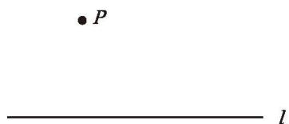

如图 1-32, 已知直线 $l$ 和 $l$ 外一点 $P$ , 用尺规作 $l$ 的垂线, 使它经过点 $P$ 。

图1-32

请按照给出的作法作出相应的图形：

<table><tr><td>作法</td><td>图形</td></tr><tr><td>1.任取一点Q,使点Q与点P在直线l两旁。2.以点P为圆心,以PQ的长为半径作弧,交直线l于点A和点B。3.作线段AB的垂直平分线m。直线m就是所要作的直线。</td><td></td></tr></table>
