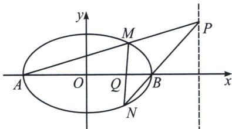

# 退化二次曲线与四点联立曲线系

## 2026版高中《mst老唐说题》圆锥曲线专题（数学）

## 一、退化二次曲线对称轴不与坐标轴平行的曲线系

模型构造： $f_{1}(x,y)+\lambda f_{2}(x,y)=\mu f_{3}(x,y)$

根据上一节的内容，如果两条直线斜率互为相反数，则它们构造的退化二次曲线也是以坐标轴平行线为对称轴，这样与圆锥曲线构造的曲线系是指向圆。但当构成退化二次曲线的两相交直线斜率不为相反数时，那么它们可以形成圆以外的其它圆锥曲线，本讲介绍四点确定椭圆、双曲线和抛物线的曲线系方程。

如图，A、B分别为椭圆 $\frac{x^{2}}{a^{2}}+\frac{y^{2}}{b^{2}}=1(a>b>0)$ 的左右顶点，M、N为椭圆上任意两点，MN与x轴交于点Q，AM与BN交于点P，我们可以理解为A，M，B，N四点确定椭圆（双曲线和抛物线也一致），那么四点之间连线有6条，我们选取一组过四点的直线乘积式构造退化二次曲线 $f_{1}(x,y)=0$ ，再选取另外两条过四点的直线乘积式构造另一退弱化的二次曲线 $f_{2}(x,y)=0$ ，可以理解为两条退化的二次曲线形成了这个椭圆 $f_{3}(x,y)=\frac{x^{2}}{a^{2}}+\frac{y^{2}}{b^{2}}-1=0$ ，即 $f_{1}(x,y)+\lambda f_{2}(x,y)=\mu f_{3}(x,y)$

注意 这里最终结果会指向一个极点极线性质 $x_{P}x_{Q}=a^{2}$ , 故在设计 $l_{AB}: y=0, l_{MN}: x-ty-m=0, f_{1}(x, y)=y \cdot (x-ty-m)=0, l_{AM}: x-t_{1}y+a=0, l_{BN}: x-t_{2}y-a=0$ $f_{2}(x, y)=(x-t_{1}y+a) \cdot (x-t_{2}y-a)=0$ , 从而得出: $y \cdot (x-ty-m)+\lambda(x-t_{1}y+a) \cdot (x-t_{2}y-a)=\mu\left(\frac{x^{2}}{a^{2}}+\frac{y^{2}}{b^{2}}-1\right)$ .

记住：曲线系只需要对比系数，确定参数，无需展开求出 $\lambda$ 和 $\mu, t, t_1, t_2$ 均是斜率倒数.

## 相关原子

- [双曲线的定义与标准方程](%E5%8F%8C%E6%9B%B2%E7%BA%BF%E7%9A%84%E5%AE%9A%E4%B9%89%E4%B8%8E%E6%A0%87%E5%87%86%E6%96%B9%E7%A8%8B.md)
- [抛物线的定义与标准方程](%E6%8A%9B%E7%89%A9%E7%BA%BF%E7%9A%84%E5%AE%9A%E4%B9%89%E4%B8%8E%E6%A0%87%E5%87%86%E6%96%B9%E7%A8%8B.md)
- [椭圆的定义与标准方程](%E6%A4%AD%E5%9C%86%E7%9A%84%E5%AE%9A%E4%B9%89%E4%B8%8E%E6%A0%87%E5%87%86%E6%96%B9%E7%A8%8B.md)
- [直线的点斜式与斜截式方程](%E7%9B%B4%E7%BA%BF%E7%9A%84%E7%82%B9%E6%96%9C%E5%BC%8F%E4%B8%8E%E6%96%9C%E6%88%AA%E5%BC%8F%E6%96%B9%E7%A8%8B.md)

## 所属组织

- [一、退化二次曲线对称轴不与坐标轴平行的曲线系](../%E7%9F%A5%E8%AF%86%E4%B8%B2%E8%81%94/mst%E8%80%81%E5%94%90%E8%AF%B4%E9%A2%98-%E5%9C%86%E9%94%A5%E6%9B%B2%E7%BA%BF-2026/%E4%B8%8A%E5%86%8C/%E7%AC%AC08%E7%AB%A0_%E8%81%94%E7%AB%8B%E8%AE%A1%E7%AE%97%E9%AB%98%E9%98%B6%E7%AF%87/%E7%AC%AC%E5%85%AD%E8%8A%82_%E4%BA%8C%E6%AC%A1%E6%9B%B2%E7%BA%BF%E6%96%B9%E7%A8%8B%E4%B8%8E%E5%9B%9B%E7%82%B9%E8%81%94%E7%AB%8B%E6%9B%B2%E7%BA%BF%E7%B3%BB/%E4%B8%80_%E9%80%80%E5%8C%96%E4%BA%8C%E6%AC%A1%E6%9B%B2%E7%BA%BF%E5%AF%B9%E7%A7%B0%E8%BD%B4%E4%B8%8D%E4%B8%8E%E5%9D%90%E6%A0%87%E8%BD%B4%E5%B9%B3%E8%A1%8C%E7%9A%84%E6%9B%B2%E7%BA%BF%E7%B3%BB/%E4%B8%80_%E9%80%80%E5%8C%96%E4%BA%8C%E6%AC%A1%E6%9B%B2%E7%BA%BF%E5%AF%B9%E7%A7%B0%E8%BD%B4%E4%B8%8D%E4%B8%8E%E5%9D%90%E6%A0%87%E8%BD%B4%E5%B9%B3%E8%A1%8C%E7%9A%84%E6%9B%B2%E7%BA%BF%E7%B3%BB.md)

## 题型训练 · 2026版高中《mst老唐说题》圆锥曲线专题（数学）

### 联立计算高阶篇 / 第六节 二次曲线方程与四点联立曲线系

> [!example]- 一、退化二次曲线对称轴不与坐标轴平行的曲线系
> 

> [!example]- 二、用曲线系方程破解高考极点极线题型
> 

> [!example]- 三、用曲线系速解坎迪定理
> 

> [!example]- 五、曲线系挖掘四点形斜率关系与隐藏轨迹
> 

> [!example]- 六、用曲线系破解彭塞列闭合定理
> 
