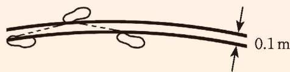

# 阅读·思考：“瞎转圈”的道理与圆周步长方程模型

## 情境引入与思考

## 知识讲解

### 北师大版初中数学·七年级上册

阅读·思考

有人曾经做过一个很有趣的实验: 100 名飞行员在草坪上整齐地排列, 把他们的眼睛都蒙起来, 然后叫他们一直向前走。起初, 他们走得还比较直; 接着一些人渐渐向右偏转, 另一些人向左偏转, 逐渐转起圈来, 最后他们又踏上了自己已走过的路径。实际上, 很久以前人们就已经注意到: 在荒漠中没有携带指南针的旅行家, 也不太能走成直线方向, 而是绕着圆圈打转, 接连多次回到他的出发点。

上面的现象看起来仿佛有点神秘, 其实道理并不复杂。人走路的时候, 只有两腿肌肉工作得完全相同, 他才可以不需要用眼睛就能走成直线。但实际上, 绝大多数人的双腿肌肉发育得并不相同。举例来说, 一位步行者左腿比右腿迈的步子大, 除非用眼睛来帮助修正走路的方向, 否则他就要向右边斜过去, 直至走成两个同心圆 (如图 5-5)。如果这个人两腿走路的时候踏脚线间的距离大约是 $10 \mathrm{~cm}$ , 即 $0.1 \mathrm{~m}$ , 那么当他走完一个圆周 (设圆周的半径为 $R \mathrm{~m}$ ) 时, 他右腿走的路程是 $2 \pi R \mathrm{~m}$ , 左腿走的路程是 $2 \pi (R + 0.1) \mathrm{~m}$ , 二者相差

$$
2 \pi \times 0.1 = 0.2 \pi (\mathrm{m}) _ {\circ}
$$

另一方面，如果他行走的平均步长为 $0.7 \mathrm{~m}$ ，那么走完一个圆周所走步数近似等于 $\frac{2 \pi R}{0.7}$ ，即左右腿所走步数都可以近似看作 $\frac{2 \pi R}{2 \times 0.7}$ 。把这个结果乘两腿步长差 $x$ （单位： $\mathrm{m}$ ），就应为两腿走完一个圆周的路程差 $0.2 \pi \mathrm{~m}$ ，即

图5-5

$$
\frac {2 \pi R x}{2 \times 0.7} = 0.2 \pi ,
$$

$$
R x = 0.14 _ {\circ}
$$

如果这个人左腿的每一步比右腿的每一步多 0.4 mm，那么蒙上眼睛后他所走圆周的半径满足方程 0.0004R=0.14，因此这一半径大约是 350 m。

## 本节例题与练习

- [例3 环形跑道上的追及与相遇问题](../%E4%B9%A0%E9%A2%98/Q070000002245.md)
- [随堂练习 5.3.3-1](../%E4%B9%A0%E9%A2%98/Q070000002246.md)

## 所属组织

- [5.3.3 行程追及相遇问题与列方程解应用题一般步骤](../%E7%9F%A5%E8%AF%86%E4%B8%B2%E8%81%94/%E5%8C%97%E5%B8%88%E5%A4%A7-%E4%B8%83%E5%B9%B4%E7%BA%A7%E4%B8%8A%E5%86%8C/%E7%AC%AC%E4%BA%94%E7%AB%A0%20%E4%B8%80%E5%85%83%E4%B8%80%E6%AC%A1%E6%96%B9%E7%A8%8B/3%20%E4%B8%80%E5%85%83%E4%B8%80%E6%AC%A1%E6%96%B9%E7%A8%8B%E7%9A%84%E5%BA%94%E7%94%A8/5.3.3%20%E8%A1%8C%E7%A8%8B%E8%BF%BD%E5%8F%8A%E7%9B%B8%E9%81%87%E9%97%AE%E9%A2%98%E4%B8%8E%E5%88%97%E6%96%B9%E7%A8%8B%E8%A7%A3%E5%BA%94%E7%94%A8%E9%A2%98%E4%B8%80%E8%88%AC%E6%AD%A5%E9%AA%A4.md)

## 相关练习组织（范围关联）

- [5.3.3 行程追及相遇问题与列方程解应用题一般步骤](../%E9%A2%98%E5%9E%8B/%E6%8C%89%E7%AB%A0%E8%8A%82%E5%88%86%E7%B1%BB/%E5%8C%97%E5%B8%88%E5%A4%A7-%E4%B8%83%E5%B9%B4%E7%BA%A7%E4%B8%8A%E5%86%8C/%E7%AC%AC%E4%BA%94%E7%AB%A0%20%E4%B8%80%E5%85%83%E4%B8%80%E6%AC%A1%E6%96%B9%E7%A8%8B/%E4%B8%80%E5%85%83%E4%B8%80%E6%AC%A1%E6%96%B9%E7%A8%8B%E7%9A%84%E5%BA%94%E7%94%A8.md)
