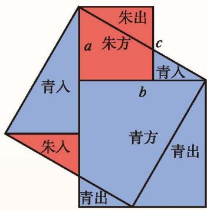
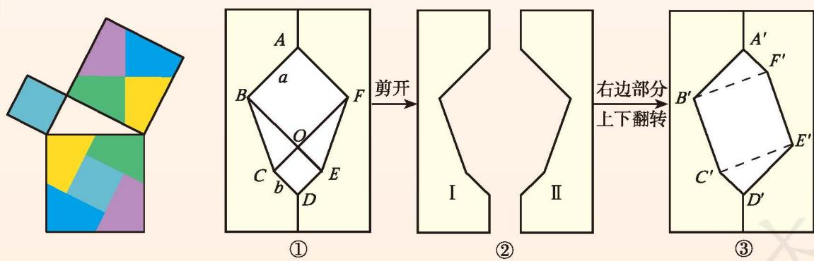

# 阅读·思考：勾股定理的无字证明

## 北师大版初中数学·八年级上册

阅读·思考

我国是最早了解勾股定理的国家之一。早在3000多年前，周朝数学家商高就提出，将一根直尺折成一个直角，如果勾等于三、股等于四，那么弦就等于五，即“勾三、股四、弦五”。它被记载于我国古代著名的数学著作《周髀》中。在这本书中的另一处，还记载了勾股定理的一般形式。我国古代验证勾股定理, 多将图形先分割再进行拼接, 拼接前后图形的面积不变, 这实际上运用了中国古代数学中非常重要的 “出入相补” 原理。你能看懂图 1-11 所示的 “青朱出入图” 是如何验证勾股定理的吗?

中国的“青朱出入图”
图 1-11

希腊发行的纪念邮票
图 1-12

相传 2000 多年前，古希腊的毕达哥拉斯学派首先证明了勾股定理，因此在很多国家，人们通常称勾股定理为毕达哥拉斯定理。毕达哥拉斯学派是以古希腊哲学家、数学家毕达哥拉斯（Pythagoras，前 580 至前 570 之间—约前 500）为代表人物的一个学派。为了纪念毕达哥拉斯学派，1955 年希腊发行了一枚纪念邮票，如图 1-12 所示。

事实上，勾股定理的证明方法十分丰富，达数百种之多。其中有一类方法尤为独特，单靠移动部分图形就直观地证明了勾股定理，被誉为“无字的证明”，让我们欣赏两种（如图1-13）！

古印度的“无字证明”

意大利画家达·芬奇的方法
图1-13
