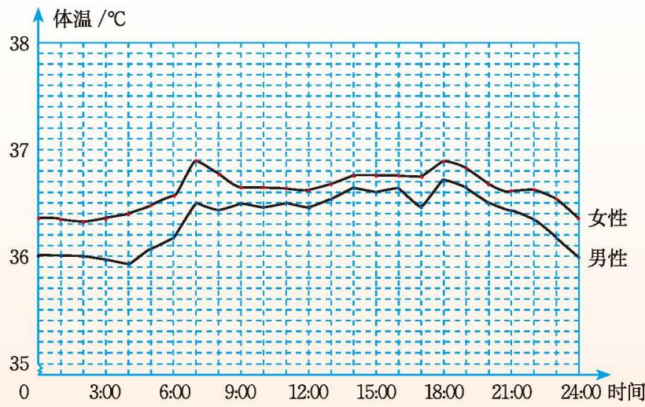

# 阅读·欣赏：人的正常体温随时间变化规律曲线

## 北师大版初中数学·七年级下册

阅读·欣赏

我们知道，人的正常体温是 $36.5^{\circ} \mathrm{C}$ 左右，这是一个很粗略的说法。

你知道人的体温是随着时间的变化而变化的吗？一天之中，在2:00到6:00之间，人的体温最低；在17:00到20:00之间，人的体温最高。在正常情况下，人体温度变化的幅度大约是 $0.6^{\circ}C$ 。如果变化幅度超过 $1^{\circ}C$ ，那可就要考虑是否生病了。

另外，人的体温还存在一定的性别差异，女性的体温比男性的要稍微高一些。

读一读图6-11，它可以帮助你更好地了解人的正常体温的变化情况。

图6-11

