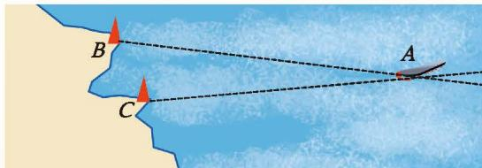

# 阅读·欣赏：平面定位的方式与经纬度原理

## 北师大版初中数学·八年级上册

阅读·欣赏

对于图 3-3 中的船只 A，可以像本节那样，选择某个参照点（如点 B），用表示方向的角和距离（一个角度、一个距离）确定它的位置；或者用点 A 相对于点 B 在东西、南北两个方向的

图3-3

距离确定它的位置，如 $A$ 在 $B$ 东面多少海里、南面多少海里（两个距离）。

也可以选择两个参照点（如图中的 B, C 两点）同时观测船只 A，得到两个表示方向的角（两个角），这样就确定了两条射线 BA, CA，船只 A 既在射线 BA 上，又在射线 CA 上，两条射线的交点就是船只的位置。当然，知道船只 A 相对于两个观测点的距离 BA, CA 也可以。

总之，要确定平面上的点，两个数据就可以了。聪明的你，想必还可以用其他数据确定船只的位置。

实际上，北斗卫星导航系统的定位原理与此类似，只是在确定空间位置时，需要通过更多的卫星确定用户终端到各卫星的距离而已。

