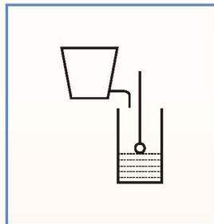
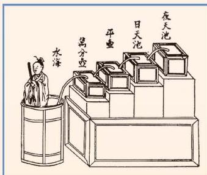

# 阅读·欣赏：漏刻计时中的一次函数思想

## 情境引入与思考

## 知识讲解

### 北师大版初中数学·八年级上册

在现代钟表发明之前，你知道古人是如何计时的吗？

本节的学习也许可以给你不少启发！实际上，香的焚烧和水的滴漏都可以用来计时。在我国古代，许多地方使用水钟计时。

水钟在我国古代叫“漏刻”或“漏壶”。图4-3是一种原始漏刻的示意图：水从上面的贮水壶慢慢漏入下方的受水壶中，受水壶中的浮子上竖直放置一根标尺（称为“漏箭”）。假设漏水量是均匀的，受水壶中的浮子就会均匀升高，也就是说浮子升高的高度 $h$ 与所经历的时间 $t$ 之间的关系是

图4-3

$h = kt$ (k 为常数)。

利用这一关系，在漏箭上标上适当的刻度，就可以用来计时了（我国古代天文学家通常将一昼夜分为100刻）。

当然，古人注意到随着贮水壶中水的减少，漏水速度会变慢，因此就出现了设置多个贮水壶（即“补偿壶”）的多级型漏壶，使水逐级下漏，以保证最后漏入受水壶的水流的均匀性（图4-4为唐代制造的一种四级漏刻的示意图）。另外，水流速度还受到四季温度变化等诸多因素的影响，因此古人设计漏刻时常常会根据实际情况采取相应措施来保证最后漏入受水壶的水流的均匀性和计时的准确性。

图4-4

## 本节例题与练习

- [4.2.3 随堂练习 第1题](../%E4%B9%A0%E9%A2%98/Q070000002532.md)
- [例2 我国居民个人所得税分段一次函数计算](../%E4%B9%A0%E9%A2%98/Q070000002531.md)

## 所属组织

- [4.2.3 一次函数与分段计费模型](../%E7%9F%A5%E8%AF%86%E4%B8%B2%E8%81%94/%E5%8C%97%E5%B8%88%E5%A4%A7-%E5%85%AB%E5%B9%B4%E7%BA%A7%E4%B8%8A%E5%86%8C/%E7%AC%AC%E5%9B%9B%E7%AB%A0%20%E4%B8%80%E6%AC%A1%E5%87%BD%E6%95%B0/2%20%E8%AE%A4%E8%AF%86%E4%B8%80%E6%AC%A1%E5%87%BD%E6%95%B0/4.2.3%20%E4%B8%80%E6%AC%A1%E5%87%BD%E6%95%B0%E4%B8%8E%E5%88%86%E6%AE%B5%E8%AE%A1%E8%B4%B9%E6%A8%A1%E5%9E%8B.md)

## 相关练习组织（范围关联）

- [4.2.3 一次函数与分段计费模型](../%E9%A2%98%E5%9E%8B/%E6%8C%89%E7%AB%A0%E8%8A%82%E5%88%86%E7%B1%BB/%E5%8C%97%E5%B8%88%E5%A4%A7-%E5%85%AB%E5%B9%B4%E7%BA%A7%E4%B8%8A%E5%86%8C/%E7%AC%AC%E5%9B%9B%E7%AB%A0%20%E4%B8%80%E6%AC%A1%E5%87%BD%E6%95%B0/%E8%AE%A4%E8%AF%86%E4%B8%80%E6%AC%A1%E5%87%BD%E6%95%B0.md)
