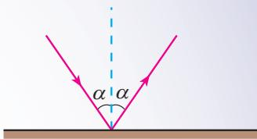
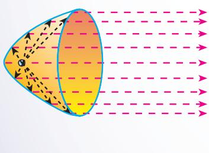
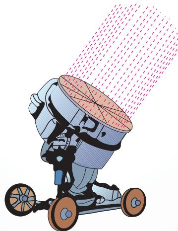
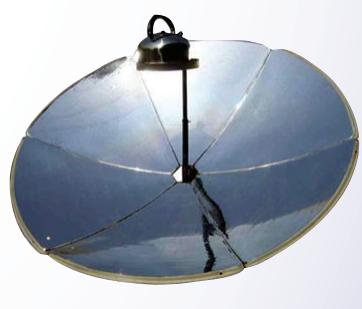
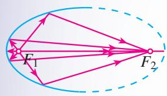
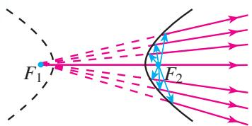
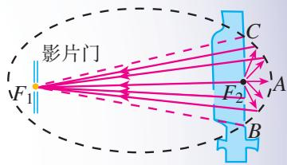

# 阅读与思考 圆锥曲线的光学性质及其应用

## 高中选择性必修 第一册·人教A版数学

椭圆、双曲线、抛物线这些圆锥曲线都有焦点。焦点，顾名思义，就是光线的聚集点。这说明圆锥曲线与光线有紧密的联系，圆锥曲线具有丰富的光学性质。

我们知道，当一束光线照到镜面时，光线会依一定的规律反射，即反射角等于入射角（图1）。当光照射到曲面时，特别是由圆锥曲线绕其对称轴旋转而成的曲面时，会有什么现象呢？

  
图1

我们看生活中的一个实例：一只很小的灯泡发出的

光，会分散地射向各方，但把它装在圆柱形手电筒里，经过适当调节，就能射出一束比较强的平行光线，这是为什么呢？

原来手电筒内，在小灯泡后面有一个反光镜，镜面的形状是一个由抛物线绕它的对称轴旋转所得到的曲面（图2），这种曲面叫做抛物面。抛物线有一条重要性质：从焦点发出的光线，经过抛物线上的一点反射后，反射光线平行于抛物线的轴。探照灯（图3）也是利用这个原理设计的。

  
图2

  
图3

  
图4

应用抛物线的这个性质，也可以使一束平行于抛物线的轴的光线，经过抛物面的反射集中于它的焦点。人们应用这个原理，设计了一种加热水和食物的太阳灶（图4）。在这种太阳灶上装有一个旋转抛物面形的反光镜，当它的轴与太阳光线平行时，太阳光线经过反射后集中于焦点处，这一点的温度就会很高。

椭圆和双曲线的光学性质与抛物线不同。从椭圆的一个焦点发出的光线，经过椭圆反射后，反射光线交于椭圆的另一个焦点上（图5）；从双曲线的一个焦点发出的光线，经过双曲线反射后，反射光线是散开的，它们就好像是从另一个焦点射出的一样（图6）．椭圆、双曲线的光学性质也被人们广泛地应用于各种设计中.

  
图5

  
图6

  
图7

如图7，胶片电影放映机的聚光灯有一个反射镜，它的形状是旋转椭圆面。为了使影片门（电影胶片通过的地方）处获得最强的光线，灯丝 $F_{2}$ 与影片门 $F_{1}$ 应位于椭圆的两个焦点处，这就是利用椭圆光学性质的一个实例。数字电影机采用数字光处理技术DLP的数字电影放映新模式，替代了传统胶片电影放映机胶片图像重现模式，实现了无胶片放映。
