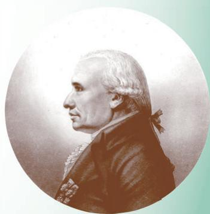

# 阅读与思考 画法几何与蒙日

## 高中必修 第二册·人教A版数学

画法几何就是在平面上绘制空间图形，并在平面图上表达出空间原物体各部分的大小、位置以及相互关系的一门学科。它在绘画、建筑等方面有着广泛的应用。

画法几何起源于欧洲文艺复兴时期的绘画和建筑技术。意大利艺术家莱奥纳多·达·芬奇（Leonardo da Vinci，1452—1519）在他的绘画作品中已经广泛地运用了透视理论，主要是中心投影。法国数学家德萨格（Gérard Desargues，

1593—1662）在他的“透视法”中给出了空间几何体透视像的画法，以及如何从平面图中正确地计算出几何体的尺寸大小的方法，主要是运用正投影。后来法国数学家蒙日经过深入研究，在1799年出版了《画法几何学》一书。在该书中，蒙日第一次详细阐述了怎样把空间（三维）物体投影到两个互相垂直的平面上，并根据投影原理（这种原理后来发展成射影几何学）推断出该空间物体的几何性质。蒙日的《画法几何学》不论是在概念上，还是在方法上都有深远的影响。这种方法对于建筑学、军事学、机械制图等方面都有极大的实用价值，从此画法几何就成为一门独立的几何分支学科。蒙日成为画法几何的创始人。

  
蒙日（Gaspard Monge，1746—1818）

蒙日生长在法国大革命时代，他出生于法国东部博衲的一个小商人家庭。16岁时，因为熟练地以比例尺绘出家乡的地图，他被梅济耶尔军事学院聘为绘图员。1768年，蒙日开始在梅济耶尔军事学院教授物理和数学，那时他只有22岁。1780年，他被选为巴黎科学院通讯院士。1783年，他迁居巴黎后，积极投身巴黎的公共事务，曾任度量衡委员会的委员、海军与殖民部长，并参与创办了巴黎综合工科学校和法兰西国家研究院。为了从数据中求出要塞中炮兵阵地的位置，蒙日用几何方法避开了麻烦的计算。他用二维平面上的适当投影来表达三维物体的方法，在实际中有着广泛的应用，并导致画法几何的产生。法国大革命前后，由于军事建筑上的迫切需要，蒙日的画法几何方法被列为军事秘密，所以很久未能公之于世。直到当时的军事约束解除后，蒙日才公布了他的研究成果，这已是他建立画法几何之后30年的事了。

## 所属组织

- [阅读与思考 画法几何与蒙日](../%E7%9F%A5%E8%AF%86%E4%B8%B2%E8%81%94/%E4%BA%BA%E6%95%99A-%E5%BF%85%E4%BF%AE%E7%AC%AC%E4%BA%8C%E5%86%8C/%E7%AC%AC%E5%85%AB%E7%AB%A0%20%E7%AB%8B%E4%BD%93%E5%87%A0%E4%BD%95%E5%88%9D%E6%AD%A5/%E9%98%85%E8%AF%BB%E4%B8%8E%E6%80%9D%E8%80%83%20%E7%94%BB%E6%B3%95%E5%87%A0%E4%BD%95%E4%B8%8E%E8%92%99%E6%97%A5.md)

## 相关练习组织（范围关联）

- [第八章 立体几何初步](../%E9%A2%98%E5%9E%8B/%E6%8C%89%E7%AB%A0%E8%8A%82%E5%88%86%E7%B1%BB/%E4%BA%BA%E6%95%99A-%E5%BF%85%E4%BF%AE%E7%AC%AC%E4%BA%8C%E5%86%8C/%E7%AC%AC%E5%85%AB%E7%AB%A0%20%E7%AB%8B%E4%BD%93%E5%87%A0%E4%BD%95%E5%88%9D%E6%AD%A5/%E7%AC%AC%E5%85%AB%E7%AB%A0%20%E7%AB%8B%E4%BD%93%E5%87%A0%E4%BD%95%E5%88%9D%E6%AD%A5.md)
