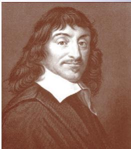
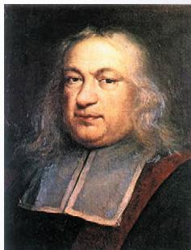

# 阅读与思考 笛卡儿与解析几何

## 高中选择性必修 第一册·人教A版数学

解析几何的创立适应了17世纪科学技术发展的迫切需要。法国数学家笛卡儿（Descartes，1596—1650）是解析几何的创始人之一。他对当时的几何方法和代数方法进行比较，分析了它们各自的优缺点。他认为，没有任何东西比几何图形更容易印入人脑，用图形表达事物非常有益。但他对欧几里得几何中许多定理的证明需要某种奇巧的想法深感不安，他还批评古希腊人的几何过

  
笛卡儿

多地依赖图形。他看到了代数的力量，认为代数在提供广泛的方法论方面高于欧几里得的几何学。他认为，代数具有一般性，例如用字母代替数时，可以代表各种数：正数、负数和0；代数中的公式可以使解题过程机械化；代数具有作为一门普遍的科学方法的潜力。

笛卡儿的中心思想是使代数和几何结合起来。他说：“我决心放弃那个仅仅是抽象的几何，这就是说，不再去考虑那些仅仅是用来练习思想的问题。我这样做，是为了研究另一种几何，即目的在于解释自然现象的几何。”

笛卡儿曾计划写一本书《思想的指导法则》，在书中他大胆地提出了一个解决一切问题的方案：把一切问题归结为数学问题，把一切数学问题归结为代数问题，把一切代数问题归结为方程，最后得到关于一个未知数的方程。可能不久他自己就发现这个设想过于大胆，根本无法实现，这本书没有写完就搁下了（在他去世后人们将它出版）。他的这个方案虽然失败了，但确有很多问题可以用列方程的方法来解。

1637年笛卡儿发表了《更好地指导推理和寻找科学真理的方法论》，这是一本哲学的经典著作，包含了三个附录，《几何学》就是其中之一。《几何学》是笛卡儿所写的唯一一本数学书。笛卡儿在《几何学》中引入了坐标方法和用方程表示曲线的思想。于是后人就把这本《几何学》的发表作为解析几何创立的标志。

笛卡儿最初所使用的坐标系中，两条坐标轴的夹角不要求一定是直角，而且y轴并没有明显地出现。至于“坐标”“坐标系”“横坐标”“纵坐标”等名词，也都是后来人们逐渐使用的。虽然笛卡儿当初的坐标系还不够完善，但是笛卡儿当初迈出的第一步具有决定意义，所以人们仍然把后来的直角坐标系，叫做笛卡儿直角坐标系。

差不多与笛卡儿同时，另一位法国数学家费马（Fermat，1601—1665）在自己的研究中也独立地形成了用方程表示曲线的思想。因此，费马和笛卡儿同为解析几何的创始人。

解析几何的创立在数学发展史上具有划时代的意义，是数学发展史上的一个里程碑。它促进了微积分的创立，从此数学进入了变量数学的新时期。正如恩格斯在《自然

  
费马

辩证法》一书中所指出的：“数学中的转折点是笛卡儿的变数，有了变数，运动进入了数学，有了变数，辩证法进入了数学，有了变数，微分和积分也就立刻成为必要的了。”

解析几何的创立提供了研究几何问题的一种新方法，借助于坐标系，把几何问题转化为代数问题来研究。这种方法具有一般性，它沟通了数学内部数与形、代数与几何两大学科之间的联系。从此代数和几何互相汲取新鲜的活力，得到迅速的发展。

## 所属组织

- [阅读与思考 笛卡儿与解析几何](../%E7%9F%A5%E8%AF%86%E4%B8%B2%E8%81%94/%E4%BA%BA%E6%95%99A-%E9%80%89%E6%8B%A9%E6%80%A7%E5%BF%85%E4%BF%AE%E7%AC%AC%E4%B8%80%E5%86%8C/%E7%AC%AC%E4%BA%8C%E7%AB%A0%20%E7%9B%B4%E7%BA%BF%E5%92%8C%E5%9C%86%E7%9A%84%E6%96%B9%E7%A8%8B/%E9%98%85%E8%AF%BB%E4%B8%8E%E6%80%9D%E8%80%83%20%E7%AC%9B%E5%8D%A1%E5%84%BF%E4%B8%8E%E8%A7%A3%E6%9E%90%E5%87%A0%E4%BD%95.md)

## 相关练习组织（范围关联）

- [第二章 直线和圆的方程](../%E9%A2%98%E5%9E%8B/%E6%8C%89%E7%AB%A0%E8%8A%82%E5%88%86%E7%B1%BB/%E4%BA%BA%E6%95%99A-%E9%80%89%E6%8B%A9%E6%80%A7%E5%BF%85%E4%BF%AE%E7%AC%AC%E4%B8%80%E5%86%8C/%E7%AC%AC%E4%BA%8C%E7%AB%A0%20%E7%9B%B4%E7%BA%BF%E5%92%8C%E5%9C%86%E7%9A%84%E6%96%B9%E7%A8%8B/%E7%AC%AC%E4%BA%8C%E7%AB%A0%20%E7%9B%B4%E7%BA%BF%E5%92%8C%E5%9C%86%E7%9A%84%E6%96%B9%E7%A8%8B.md)
