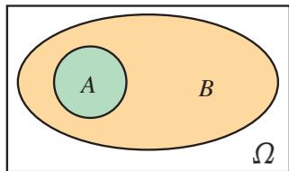
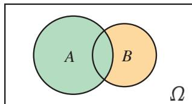
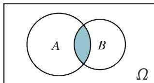
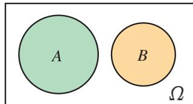
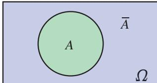

从前面的学习中可以看到，我们在一个随机试验中可以定义很多随机事件。这些事件有的简单，有的复杂。我们希望从简单事件的概率推算出复杂事件的概率，所以需要研究事件之间的关系和运算。

利用样本空间的子集表示事件，使我们可以利用集合的知识研究随机事件，从而为研究概率的性质和计算等提供有效而简便的方法。以掷骰子试验（观察骰子朝上面的点数，样本空间 $\Omega = \{1, 2, 3, 4, 5, 6\}$ ）为例，定义随机事件 $C_{i} =$ “点数为 $i$ ”（ $i=1,2,3,4,5,6$ ）， $D_{1} =$ “点数不大于 3”， $D_{2} =$ “点数大于 3”， $E_{1} =$ “点数为 1 或 2”， $E_{2} =$ “点数为 2 或 3”， $F =$ “点数为偶数”， $G =$ “点数为奇数”，下面借助集合的关系和运算展开研究。

1. 用集合的形式表示事件 $C_1 =$ “点数为1”和事件 $G =$ “点数为奇数”，它们分别是 $C_1 = \{1\}$ 和 $G = \{1,3,5\}$

显然，如果事件 $C_1$ 发生，那么事件 $G$ 一定发生。事件之间的这种关系用集合的形式表示，就是 $\{1\} \subseteq \{1, 3, 5\}$ ，即 $C_1 \subseteq G$ 。这时我们说事件 $G$ 包含事件 $C_1$ 。

一般地，若事件 A 发生，则事件 B 一定发生，我们就称事件 B 包含事件 A（或事件 A 包含于事件 B），记作 $B \supseteq A$ （或 $A \subseteq B$ ）。可以用图 10.1-4 表示。

图10.1-4

特别地，如果事件 $B$ 包含事件 $A$ ，事件 $A$ 也包含事件 $B$ ，即 $B \supseteq A$ 且 $A \supseteq B$ ，则称事件 $A$ 与事件 $B$ 相等，记作 $A = B$ .

2. 用集合的形式表示事件 $D_{1} =$ “点数不大于3”、事件 $E_{1} =$ “点数为1或2”和事件 $E_{2} =$ “点数为2或3”，它们分别是 $D_{1} = \{1,2,3\}$ ， $E_{1} = \{1,2\}$ 和 $E_{2} = \{2,3\}$

可以发现，事件 $E_{1}$ 和事件 $E_{2}$ 至少有一个发生，相当于事件 $D_{1}$ 发生。事件之间的这种关系用集合的形式表示，就是 $\{1, 2\} \cup \{2, 3\} = \{1, 2, 3\}$ ，即 $E_{1} \cup E_{2} = D_{1}$ ，这时我们称事件 $D_{1}$ 为事件 $E_{1}$ 和事件 $E_{2}$ 的并事件。

一般地，事件 A 与事件 B 至少有一个发生，这样的一个事件中的样本点或者在事件 A 中，或者在事件 B 中，我们称这个事件为事件 A 与事件 B 的并事件（或和事件），记作 $A \cup B$ （或 $A + B$ ）。可以用图 10.1-5 中的绿色区域和黄色区域表示这个并事件。

  
图10.1-5

3. 事件 $C_2 =$ “点数为2”可以用集合的形式表示为 $C_2 = \{2\}$

可以发现，事件 $E_{1} = \text{“点数为 1 或 2”}$ 和事件 $E_{2} = \text{“点数为 2 或 3”}$ 同时发生，相当于事件 $C_{2}$ 发生。事件之间的这种关系用集合的形式表示，就是 $\{1, 2\} \cap \{2, 3\} = \{2\}$ ，即 $E_{1} \cap E_{2} = C_{2}$ 。我们称事件 $C_{2}$ 为事件 $E_{1}$ 和 $E_{2}$ 的交事件。

一般地，事件 A 与事件 B 同时发生，这样的一个事件中的样本点既在事件 A 中，也在事件 B 中，我们称这样的一个事件为事件 A 与事件 B 的交事件（或积事件），记作 $A \cap B$ （或 AB）。可以用图 10.1-6 中的蓝色区域表示这个交事件。

  
图10.1-6

4. 用集合的形式表示事件 $C_3 =$ “点数为3”和事件 $C_4 =$ “点数为4”，它们分别是 $C_3 = \{3\}$ ， $C_4 = \{4\}$

显然，事件 $C_3$ 与事件 $C_4$ 不可能同时发生，用集合的形式表示这种关系，就是 $\{3\} \cap \{4\} = \emptyset$ ，即 $C_3 \cap C_4 = \emptyset$ ，这时我们称事件 $C_3$ 与事件 $C_4$ 互斥.

一般地，如果事件 A 与事件 B 不能同时发生，也就是说 $A \cap B$ 是一个不可能事件，即 $A \cap B = \varnothing$ ，则称事件 A 与事件 B 互斥（或互不相容）。可以用图 10.1-7 表示这两个事件互斥。

  
图10.1-7

5. 用集合的形式表示事件 $F =$ “点数为偶数”、事件 $G =$ “点数为奇数”，它们分别是 $F = \{2, 4, 6\}$ ， $G = \{1, 3, 5\}$ .

在任何一次试验中，事件 $F$ 与事件 $G$ 两者只能发生其中之一，而且也必然发生其中之一。事件之间的这种关系，用集合的形式可以表示为 $\{2, 4, 6\} \cup \{1, 3, 5\} = \{1, 2, 3, 4, 5, 6\}$ ，即 $F \cup G = \Omega$ ，且 $\{2, 4, 6\} \cap \{1, 3, 5\} = \emptyset$ ，即 $F \cap G = \emptyset$ 。此时我们称

事件 $F$ 与事件 $G$ 互为对立事件. 事件 $D_{1}$ 与 $D_{2}$ 也有这种关系.

一般地，如果事件 A 和事件 B 在任何一次试验中有且仅有一个发生，即 $A \cup B = \Omega$ ，且 $A \cap B = \varnothing$ ，那么称事件 A 与事件 B 互为对立。事件 A 的对立事件记为 $\bar{A}$ ，可以用图 10.1-8 表示。

  
图10.1-8

综上所述，事件的关系或运算的含义，以及相应的符号表示如下（表 10.1-1）：

表10.1-1

<table><tr><td>事件的关系或运算</td><td>含义</td><td>符号表示</td></tr><tr><td>包含</td><td>A发生导致B发生</td><td>A⊆B</td></tr><tr><td>并事件(和事件)</td><td>A与B至少一个发生</td><td>A∪B或A+B</td></tr><tr><td>交事件(积事件)</td><td>A与B同时发生</td><td>A∩B或AB</td></tr><tr><td>互斥(互不相容)</td><td>A与B不能同时发生</td><td>A∩B=∅</td></tr><tr><td>互为对立</td><td>A与B有且仅有一个发生</td><td>A∩B=∅, A∪B=Ω</td></tr></table>

类似地，我们可以定义多个事件的和事件以及积事件。例如，对于三个事件 $A, B, C, A \cup B \cup C$ （或 $A + B + C$ ）发生当且仅当 $A, B, C$ 中至少一个发生， $A \cap B \cap C$ （或 $ABC$ ）发生当且仅当 $A, B, C$ 同时发生，等等。
