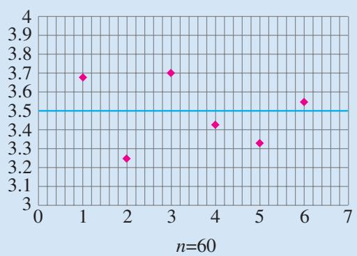
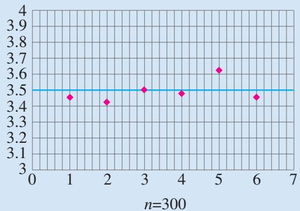

以掷一枚质地均匀的骰子为例，掷出的点数 $X$ 的均值为 $3.5$ 。随机模拟这个试验，重复 60 次和重复 300 次各做 6 次，观测出现的点数并计算样本均值，绘制的统计图分别如图 7.3-1（1）和（2）所示。

  
(1)

  
图7.3-1  
(2)

观察图 7.3-1 可以发现：在这 12 组掷骰子试验中，样本均值各不相同，但它们都在掷出点数 $X$ 的均值 $3.5$ 附近波动，且重复掷 300 次的样本均值波动幅度明显小于重复 60 次的.

事实上，随机变量的均值是一个确定的数，而样本均值具有随机性，它围绕随机变量的均值波动。随着重复试验次数的增加，样本均值的波动幅度一般会越来越小。因此，我们常用随机变量的观测值的均值去估计随机变量的均值。
