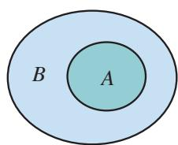

# 集合间的基本关系

## 知识讲解

一般地，对于两个集合 A，B，如果集合 A 中任意一个元素都是集合 B 中的元素，就称集合 A 为集合 B 的子集 (subset)，记作

$$
A \subseteq B (\text {或} B \supseteq A),
$$

读作 “A 包含于 B”（或 “B 包含 A”）.

在数学中，我们经常用平面上封闭曲线的内部代表集合，这种图称为Venn图．这样，上述集合 $A$ 与集合 $B$ 的包含关系，可以用图1.2-1表示.

图1.2-1

一般地，如果集合 A 的任何一个元素都是集合 B 的元素，同时集合 B 的任何一个元素都是集合 A 的元素，那么集合 A 与集合 B 相等，记作 A=B .

请你举出几个具有包含关系、相等关系的集合实例.

也就是说，若 $A \subseteq B$ ，且 $B \subseteq A$ ，则 $A = B$ .

如果集合 $A \subseteq B$ ，但存在元素 $x \in B$ ，且 $x \notin A$ ，就称集合 $A$ 是集合 $B$ 的真子集（proper subset），记作

$$
A \subsetneqq B (\text {或} B \supsetneqq A),
$$

与实数中的结论“若 $a \geqslant b$ ，且 $b \geqslant a$ ，则 $a = b$ ”相类比，你有什么体会？

读作 “A 真包含于 B”（或 “B 真包含 A”）.

我们知道，方程 $x^{2} + 1 = 0$ 没有实数根，所以方程 $x^{2} + 1 = 0$ 的实数根组成的集合中没有元素.

你能举出几个空集的例子吗？

一般地，我们把不含任何元素的集合叫做空集（empty set），记为 $\varnothing$ ，并规定：空集是任何集合的子集.

## 先修知识

- [集合与元素](%E9%9B%86%E5%90%88%E4%B8%8E%E5%85%83%E7%B4%A0--000001.md)

## 本节例题与练习

- [习题1.2 复习巩固 第1题](../%E4%B9%A0%E9%A2%98/Q4079037664889977244.md)
- [习题1.2 复习巩固 第2题](../%E4%B9%A0%E9%A2%98/Q3600472967084043691.md)
- [习题1.2 综合运用 第3题](../%E4%B9%A0%E9%A2%98/Q7756438251672875150.md)
- [习题1.2 综合运用 第4题](../%E4%B9%A0%E9%A2%98/Q16542247437762502417.md)
- [例 1 写出集合 $\{a, b\}$](../%E4%B9%A0%E9%A2%98/Q8583490034423017864.md)
- [例 2 判断下列各题中集合 $A$ 是](../%E4%B9%A0%E9%A2%98/Q15910997090755278215.md)
- [练习 1](../%E4%B9%A0%E9%A2%98/Q12549428825015463135.md)
- [练习 2](../%E4%B9%A0%E9%A2%98/Q3945809648205692426.md)
- [练习 3](../%E4%B9%A0%E9%A2%98/Q6356678653955663268.md)

## 所属组织

- [1.2 集合间的基本关系](../%E7%9F%A5%E8%AF%86%E4%B8%B2%E8%81%94/%E4%BA%BA%E6%95%99A-%E5%BF%85%E4%BF%AE%E7%AC%AC%E4%B8%80%E5%86%8C/%E7%AC%AC%E4%B8%80%E7%AB%A0%20%E9%9B%86%E5%90%88%E4%B8%8E%E5%B8%B8%E7%94%A8%E9%80%BB%E8%BE%91%E7%94%A8%E8%AF%AD/1.2%20%E9%9B%86%E5%90%88%E9%97%B4%E7%9A%84%E5%9F%BA%E6%9C%AC%E5%85%B3%E7%B3%BB/1.2%20%E9%9B%86%E5%90%88%E9%97%B4%E7%9A%84%E5%9F%BA%E6%9C%AC%E5%85%B3%E7%B3%BB.md)

## 相关练习组织（范围关联）

- [1.2 集合间的基本关系](../%E9%A2%98%E5%9E%8B/%E4%BA%BA%E6%95%99A-%E5%BF%85%E4%BF%AE%E7%AC%AC%E4%B8%80%E5%86%8C/%E7%AC%AC%E4%B8%80%E7%AB%A0%20%E9%9B%86%E5%90%88%E4%B8%8E%E5%B8%B8%E7%94%A8%E9%80%BB%E8%BE%91%E7%94%A8%E8%AF%AD/1.2%20%E9%9B%86%E5%90%88%E9%97%B4%E7%9A%84%E5%9F%BA%E6%9C%AC%E5%85%B3%E7%B3%BB/1.2%20%E9%9B%86%E5%90%88%E9%97%B4%E7%9A%84%E5%9F%BA%E6%9C%AC%E5%85%B3%E7%B3%BB.md)
