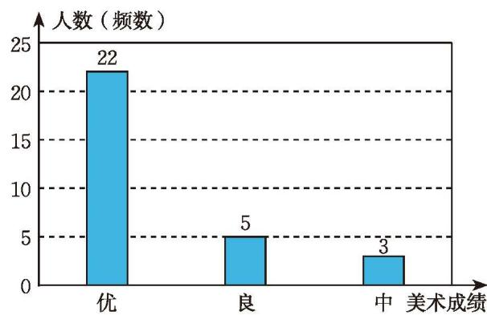
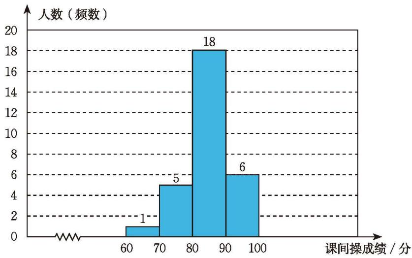

# 频数直方图的概念与数据分段整理方法

## 北师大版初中数学·七年级上册

表 6-2 是本章第 1 节七（1）班学生的部分数据信息。

表 6-2 七（1）班全班学生部分数据表

<table><tr><td>学号</td><td>性别</td><td>肺活量 /mL</td><td>立定跳远成绩 /cm</td><td>课间操成绩 /分</td><td>美术成绩</td><td>学号</td><td>性别</td><td>肺活量 /mL</td><td>立定跳远成绩 /cm</td><td>课间操成绩 /分</td><td>美术成绩</td></tr><tr><td>1</td><td>男</td><td>2 926</td><td>180</td><td>81</td><td>优</td><td>8</td><td>男</td><td>4 480</td><td>211</td><td>79</td><td>优</td></tr><tr><td>2</td><td>男</td><td>2 234</td><td>154</td><td>78</td><td>良</td><td>9</td><td>男</td><td>3 617</td><td>160</td><td>72</td><td>中</td></tr><tr><td>3</td><td>女</td><td>2 540</td><td>165</td><td>86</td><td>优</td><td>10</td><td>女</td><td>3 240</td><td>143</td><td>86</td><td>优</td></tr><tr><td>4</td><td>男</td><td>3 720</td><td>172</td><td>81</td><td>中</td><td>11</td><td>男</td><td>3 377</td><td>205</td><td>91</td><td>优</td></tr><tr><td>5</td><td>男</td><td>3 212</td><td>183</td><td>94</td><td>优</td><td>12</td><td>男</td><td>2 312</td><td>175</td><td>80</td><td>良</td></tr><tr><td>6</td><td>男</td><td>2 361</td><td>165</td><td>83</td><td>良</td><td>13</td><td>女</td><td>2 843</td><td>148</td><td>85</td><td>优</td></tr><tr><td>7</td><td>女</td><td>2 397</td><td>135</td><td>88</td><td>优</td><td>14</td><td>男</td><td>2 984</td><td>207</td><td>90</td><td>优</td></tr><tr><td>15</td><td>女</td><td>2 077</td><td>145</td><td>91</td><td>优</td><td>23</td><td>女</td><td>3 024</td><td>165</td><td>87</td><td>优</td></tr><tr><td>16</td><td>男</td><td>2 829</td><td>188</td><td>83</td><td>优</td><td>24</td><td>女</td><td>3 189</td><td>189</td><td>82</td><td>优</td></tr><tr><td>17</td><td>男</td><td>3 346</td><td>198</td><td>86</td><td>优</td><td>25</td><td>女</td><td>2 511</td><td>165</td><td>68</td><td>中</td></tr><tr><td>18</td><td>女</td><td>2 504</td><td>177</td><td>92</td><td>优</td><td>26</td><td>女</td><td>2 646</td><td>152</td><td>88</td><td>优</td></tr><tr><td>19</td><td>女</td><td>3 240</td><td>157</td><td>83</td><td>优</td><td>27</td><td>女</td><td>2 385</td><td>150</td><td>80</td><td>优</td></tr><tr><td>20</td><td>男</td><td>2 939</td><td>157</td><td>75</td><td>良</td><td>28</td><td>女</td><td>3 504</td><td>150</td><td>82</td><td>优</td></tr><tr><td>21</td><td>男</td><td>4 029</td><td>171</td><td>86</td><td>优</td><td>29</td><td>男</td><td>2 517</td><td>180</td><td>78</td><td>良</td></tr><tr><td>22</td><td>女</td><td>3 022</td><td>162</td><td>91</td><td>优</td><td>30</td><td>女</td><td>2 914</td><td>163</td><td>89</td><td>优</td></tr></table>

(1) 你能用恰当的统计图表表示该班学生的美术成绩吗? 从你的图表中能看出大部分学生处于哪个等级吗? 成绩的整体分布情况怎样?

(2) 你能用恰当的统计图表表示该班学生的课间操成绩吗? 从你的图表中能看出大部分学生处于哪个分数段吗? 分数的整体分布情况怎样?

对于（1），可以采用表格的形式，也可以采用条形统计图的形式（如图6-10）。

<table><tr><td>美术成绩</td><td>优</td><td>良</td><td>中</td></tr><tr><td>人数(频数)1</td><td>22</td><td>5</td><td>3</td></tr></table>

图6-10

对于（2），可以借鉴美术成绩的表示，将课间操成绩每10分为一段分

组，统计每个分数段的学生人数，得到下面的表格和统计图（如图 6-11）。

<table><tr><td>课间操成绩/分</td><td>60~70</td><td>70~80</td><td>80~90</td><td>90~100</td></tr><tr><td>人数(频数)</td><td>1</td><td>5</td><td>18</td><td>6</td></tr></table>

图6-11

你能明白这种统计图的画法吗？
像图 6-11 这样的统计图称为频数直方图。当遇到大量的数据或数据连续取值时，我们通常先将数据适当分组，然后绘制频数直方图直观地反映数据的整体分布状况。
