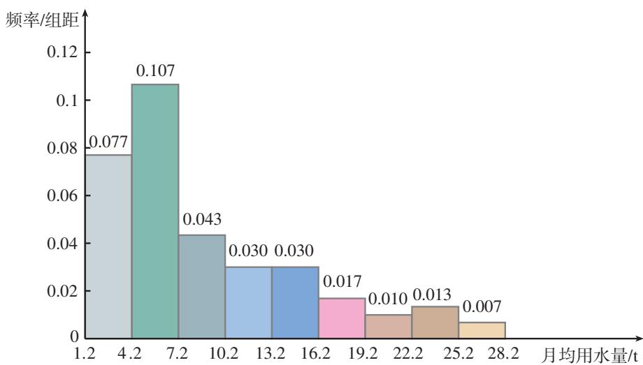
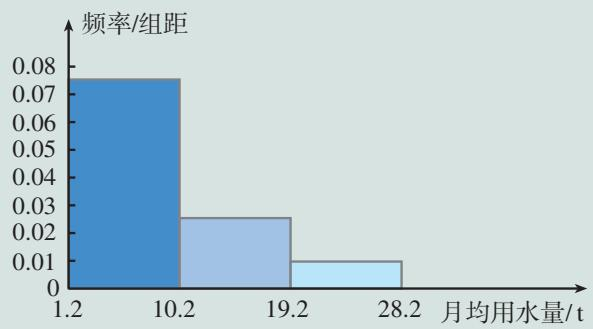
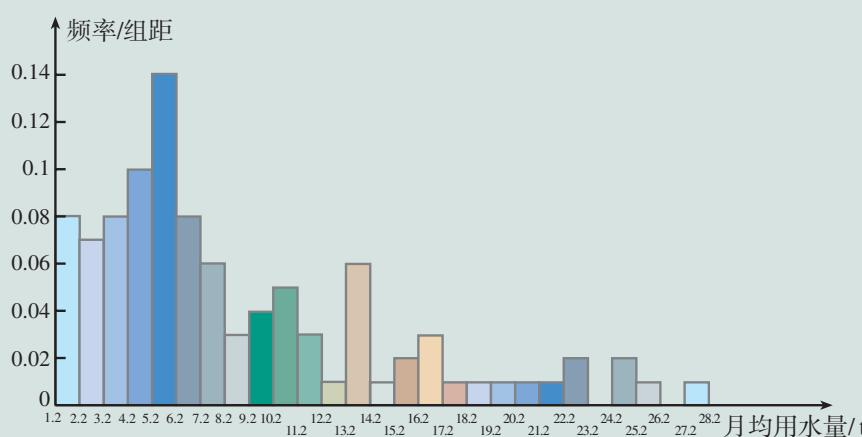

极差为一组数据中最大值与最小值的差。以 100 户居民用户月均用水量的样本观测数据为例，其最小值是 $1.3 \mathrm{t}$ , 最大值是 $28.0 \mathrm{t}$ , 极差为

$$
2 8. 0 - 1. 3 = 2 6. 7,
$$

这说明样本观测数据的变化范围是 26.7 t.

合适的组距与组数对发现数据分布规律有重要意义。组数太多或太少，都会影响我们了解数据的分布情况。组距与组数的确定没有固定的标准，常常需要一个尝试和选择的过程。数据分组的组数与数据的个数有关，一般数据的个数越多，所分组数也越多。当样本量不超过100时，常分成5～12组。为方便起见，一般取等长组距，并且组距应力求

数据分组可以是等距的，也可以是不等距的，要根据数据的特点而定。有时为了方便，往往按等距分组，或者除了第一和最后的两段，其他各段按等距分组。

“取整”.

分组时可以先确定组距，也可以先确定组数．如果我们取所有组距为3，则

$$
\frac {\text {极差}}{\text {组距}} = \frac {2 6 . 7}{3} = 8. 9,
$$

即可以将数据分为 9 组，这也说明这个组距是比较合适的.

由于组距为3，9个组距的长度超过极差，我们可以使第一组的左端点略小于数据中的最小值，最后一组的右端点略大于数据中的最大值。例如，可以取区间为[1.2，28.2]，按如下方式把样本观测数据以组距3分为9组：

[1.2, 4.2), [4.2, 7.2), …, [25.2, 28.2].

计算各小组的频率，例如第一小组的频率是

$$
\frac {\text {   第一组频数   }}{\text {   样本量   }} = \frac {2 3}{1 0 0} = 0. 2 3.
$$

作出频率分布表（表9.2-1）.

表9.2-1

<table><tr><td>分组</td><td>频数累计</td><td>频数</td><td>频率</td></tr><tr><td>[1.2, 4.2)</td><td>正正正正下</td><td>23</td><td>0.23</td></tr><tr><td>[4.2, 7.2)</td><td>正正正正正下</td><td>32</td><td>0.32</td></tr><tr><td>[7.2, 10.2)</td><td>正正下</td><td>13</td><td>0.13</td></tr><tr><td>[10.2, 13.2)</td><td>正正</td><td>9</td><td>0.09</td></tr><tr><td>[13.2, 16.2)</td><td>正正</td><td>9</td><td>0.09</td></tr><tr><td>[16.2, 19.2)</td><td>正</td><td>5</td><td>0.05</td></tr><tr><td>[19.2, 22.2)</td><td>下</td><td>3</td><td>0.03</td></tr><tr><td>[22.2, 25.2)</td><td>正</td><td>4</td><td>0.04</td></tr><tr><td>[25.2, 28.2]</td><td>T</td><td>2</td><td>0.02</td></tr><tr><td>合计</td><td></td><td>100</td><td>1.00</td></tr></table>

根据表 9.2-1 可以得到如图 9.2-1 所示的频率分布直方图.

在图 9.2-1 中，横轴表示月均用水量，纵轴表示 $\frac{频率}{组距}$ . 这里， $\frac{频率}{组距}$ 实际上就是频率分布直方图中各小长方形的高度，它反映了各组样本观测数据的疏密程度. 因为

$$
\mathrm{小长方形的面积} = \mathrm{组距} \times \frac {\mathrm{频率}}{\mathrm{组距}} = \mathrm{频率},
$$

所以各小长方形的面积表示相应各组的频率。这样，频率分布直方图就以面积的形式反映了数据落在各个小组的频率的大小。容易知道，在频率分布直方图中，各小长方形的面积的总和等于1，即样本数据落在整个区间的频率为1。

利用统计软件，可以快速、准确地画出频率分布直方图，频率分布直方图把样本数据落在各小组的比例大小直观化，更有利于我们从整体上把握数据分布的特点.

  
图9.2-1

从频率分布表 9.2-1 可以清楚地看出，样本观测数据落在各个小组的比例大小。例如，月均用水量在区间 $[4.2, 7.2)$ 内的居民用户最多，在区间 $[1.2, 4.2)$ 内的次之，而月均用水量超过 16.2 的各区间内数据所占比例较小，等等。

从频率分布直方图9.2-1容易看出，居民用户月均用水量的样本观测数据的分布是不对称的，图形的左边高、右边低，右边有一个较长的“尾巴”。这表明大部分居民用户的月均用水量集中在一个较低值区域，尤其在区间[1.2，7.2）最为集中，少数居民用户的月均用水量偏多，而且随着月均用水量的增加，居民用户数呈现降低趋势。

有了样本观测数据的频率分布，我们可以用它估计总体的取值规律。根据100户居民用户的月均用水量的频率分布，可以推测该市全体居民用户月均用水量也会有类似的分布，即大部分居民用户月均用水量集中在较低值区域。这使我们确定用水量标准时，可以定一个合适的值，以达到既不影响大多数居民用户的水费支出，又能节水的目的。需要注意的是，由于样本的随机性，这种估计可能会存在一定误差，但这一误差一般不会影响我们对总体分布情况的大致了解。

分别以 3 和 27 为组数，对 100 户居民用户月均用水量数据进行等距分组，画出频率分布直方图（图 9.2-2），可以考察不同组数对于直方图呈现数据分布规律的影响。

  
(1) “组数为 3”

  
(2) “组数为 27”  
图9.2-2

从图9.2-2中可以看出，同一组数据，组数不同，得到的直方图形状也不尽相同。图9.2-2（1）中直方图的组数少、组距大，从图中容易看出，数据分布的整体规律是随着月均用水量的增加，居民用户数的频率在降低，而且月均用水量在区间[1.2，10.2）内的居民用户数的频率，远大于在另两个区间[10.2，19.2）和[19.2，28.2]内的频率，这说明大部分居民用户的月均用水量都少于 $10.2\mathrm{t}$ 。图9.2-2（2）中直方图的组数多、组距小，从图中可以看出，数据主要集中在低值区，尤其在区间[5.2，6.2）内最为集中。从总体上看，随着月均用水量的增加，居民用户数的频率呈现下降趋势，但存在个别区间频

率变大或者缺失的现象.

从上述分析可见，当频率分布直方图的组数少、组距大时，容易从中看出数据整体的分布特点，但由于无法看出每组内的数据分布情况，损失了较多的原始数据信息；当频率分布直方图的组数多、组距小时，保留了较多的原始数据信息，但由于小长方形较多，有时图形会变得非常不规则，不容易从中看出总体数据的分布特点.

这里我们再次指出，对于同一组数据，因为组距、组数不同而得到不同形状的直方图，会给人以不同的频率分布印象，这种印象有时会影响人们对总体的判断。因此，我们要注意积累数据分组、合理使用图表的经验。
