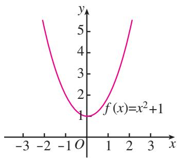
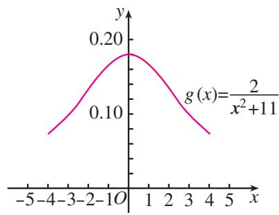

# 3.2.2 奇偶性·探究

探究

类比函数单调性，你能用符号语言精确地描述“函数图象关于 $y$ 轴对称”这一特征吗？

不妨取自变量的一些特殊值，观察相应函数值的情况，如表 3.2-1.

表3.2-1

<table><tr><td>x</td><td>...</td><td>-3</td><td>-2</td><td>-1</td><td>0</td><td>1</td><td>2</td><td>3</td><td>...</td></tr><tr><td> $f(x)=x^{2}$ </td><td>...</td><td>9</td><td>4</td><td>1</td><td>0</td><td>1</td><td>4</td><td>9</td><td>...</td></tr><tr><td> $g(x)=2-|x|$ </td><td>...</td><td>-1</td><td>0</td><td>1</td><td>2</td><td>1</td><td>0</td><td>-1</td><td>...</td></tr></table>

可以发现，当自变量取一对相反数时，相应的两个函数值相等.

例如，对于函数 $f(x)=x^{2}$ ，有

$$
\begin{array}{l} f (- 3) = 9 = f (3); \\ f (- 2) = 4 = f (2); \\ f (- 1) = 1 = f (1). \end{array}
$$

请你仿照这个过程，说明函数 $g(x)=2-|x|$ 也是偶函数.

实际上， $\forall x \in \mathbb{R}$ ，都有 $f(-x) = (-x)^2 = x^2 = f(x)$ ，这时称函数 $f(x) = x^2$ 为偶函数。

一般地，设函数 $f(x)$ 的定义域为 $D$ ，如果 $\forall x \in D$ ，都有 $-x \in D$ ，且 $f(-x) = f(x)$ ，那么函数 $f(x)$ 就叫做偶函数（even function）.

例如，函数 $f(x) = x^{2} + 1$ ， $g(x) = \frac{2}{x^2 + 11}$ 都是偶函数，它们的图象分别如图3.2-7(1)(2）所示.

  
(1)

  
(2)  
图3.2-7

## 引出的知识

- [偶函数](../%E7%9F%A5%E8%AF%86%E7%82%B9/%E5%81%B6%E5%87%BD%E6%95%B0--000034.md)

## 本节相关知识（范围关联）

- [偶函数](../%E7%9F%A5%E8%AF%86%E7%82%B9/%E5%81%B6%E5%87%BD%E6%95%B0--000034.md)
- [奇函数](../%E7%9F%A5%E8%AF%86%E7%82%B9/%E5%A5%87%E5%87%BD%E6%95%B0--000035.md)

## 所属组织

- [3.2.2 奇偶性](../%E7%9F%A5%E8%AF%86%E4%B8%B2%E8%81%94/%E4%BA%BA%E6%95%99A-%E5%BF%85%E4%BF%AE%E7%AC%AC%E4%B8%80%E5%86%8C/%E6%95%99%E6%9D%90%E9%97%AE%E9%A2%98%E9%A1%BA%E5%BA%8F/%E7%AC%AC%E4%B8%89%E7%AB%A0%20%E5%87%BD%E6%95%B0%E7%9A%84%E6%A6%82%E5%BF%B5%E4%B8%8E%E6%80%A7%E8%B4%A8/3.2%20%E5%87%BD%E6%95%B0%E7%9A%84%E5%9F%BA%E6%9C%AC%E6%80%A7%E8%B4%A8/3.2.2%20%E5%A5%87%E5%81%B6%E6%80%A7.md)
