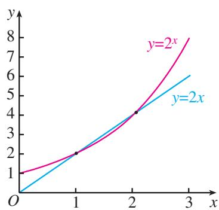
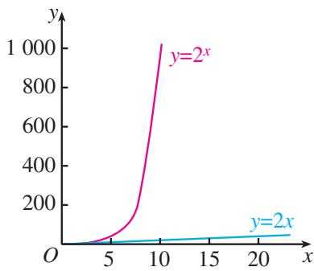

# 4.4.3 不同函数增长的差异·探究

探究

选取适当的指数函数与一次函数，探索它们在区间 $[0, +\infty)$ 上的增长差异，你能描述一下指数函数增长的特点吗？

不妨以函数 $y = 2^{x}$ 和 $y = 2x$ 为例.

利用信息技术，列出上述两个函数的自变量与函数值的对应值表（表4.4-3），并在同一直角坐标系中画出它们的图象（图4.4-5）。可以看到，函数 $y = 2^{x}$ 和 $y = 2x$ 的图象有两个交点(1,2)，(2,4)。在区间[0,1)上，函数 $y = 2^{x}$ 的图象位于 $y = 2x$ 的图象之上， $2^{x} > 2x$ ；在区间(1,2)上，函数 $y = 2^{x}$ 的图象位于 $y = 2x$ 的图象之下， $2^{x} < 2x$ ；在区间(2,3)上，函数 $y = 2^{x}$ 的图象位于 $y = 2x$ 的图象之上， $2^{x} > 2x$ 。这表明，虽然这两个函数在[0，+∞)上都单调递增，但它们的增长速度不同，函数 $y = 2x$ 的增长速度保持不变，而函数 $y = 2^{x}$ 的增长速度在变化。

表4.4-3

<table><tr><td>x</td><td> $y=2^{x}$ </td><td>y=2x</td></tr><tr><td>0</td><td>1</td><td>0</td></tr><tr><td>0.5</td><td>1.414</td><td>1</td></tr><tr><td>1</td><td>2</td><td>2</td></tr><tr><td>1.5</td><td>2.828</td><td>3</td></tr><tr><td>2</td><td>4</td><td>4</td></tr><tr><td>2.5</td><td>5.657</td><td>5</td></tr><tr><td>3</td><td>8</td><td>6</td></tr><tr><td>...</td><td>...</td><td>...</td></tr></table>

  
图4.4-5  
下面在更大的范围内，观察 $y=2^{x}$ 和 y=2x 的增长情况.

从表4.4-4和图4.4-6可以看到，当自变量 $x$ 越来越大时， $y = 2^x$ 的图象就像与 $x$ 轴垂直一样， $2^x$ 的值快速增长；而函数 $y = 2x$ 的增长速度依然保持不变，与函数 $y = 2^x$ 的增长速度相比几乎微不足道.

表4.4-4

<table><tr><td>x</td><td> $y=2^{x}$ </td><td>y=2x</td></tr><tr><td>0</td><td>1</td><td>0</td></tr><tr><td>2</td><td>4</td><td>4</td></tr><tr><td>4</td><td>16</td><td>8</td></tr><tr><td>6</td><td>64</td><td>12</td></tr><tr><td>8</td><td>256</td><td>16</td></tr><tr><td>10</td><td>1 024</td><td>20</td></tr><tr><td>12</td><td>4 096</td><td>24</td></tr><tr><td>...</td><td>...</td><td>...</td></tr></table>

  
图4.4-6

综上所述，虽然函数 $y = 2^{x}$ 与 $y = 2x$ 在区间 $[0, +\infty)$ 上都单调递增，但它们的增长速度不同，而且不在同一个“档次”上。随着 $x$ 的增大， $y = 2^{x}$ 的增长速度越来越快，会超过并远远大于 $y = 2x$ 的增长速度。尽管在 $x$ 的一定变化范围内， $2^{x}$ 会小于 $2x$ ，但由于 $y = 2^{x}$ 的增长最终会快于 $y = 2x$ 的增长，因此，总会存在一个 $x_{0}$ ，当 $x > x_{0}$ 时，恒有 $2^{x} > 2x$ 。

一般地，指数函数 $y = a^{x} (a > 1)$ 与一次函数 $y = kx (k > 0)$ 的增长差异都与上述情况类似。即使 $k$ 的值远远大于 $a$ 的值， $y = a^{x} (a > 1)$ 的增长速度最终都会大大超过 $y = kx (k > 0)$ 的增长速度。

指数函数不像一次函数那样按同一速度增长，而是越来越快，呈爆炸性增长.

## 所属组织

- [4.4.3 不同函数增长的差异](../%E7%9F%A5%E8%AF%86%E4%B8%B2%E8%81%94/%E4%BA%BA%E6%95%99A-%E5%BF%85%E4%BF%AE%E7%AC%AC%E4%B8%80%E5%86%8C/%E6%95%99%E6%9D%90%E9%97%AE%E9%A2%98%E9%A1%BA%E5%BA%8F/%E7%AC%AC%E5%9B%9B%E7%AB%A0%20%E6%8C%87%E6%95%B0%E5%87%BD%E6%95%B0%E4%B8%8E%E5%AF%B9%E6%95%B0%E5%87%BD%E6%95%B0/%E6%8E%A2%E7%A9%B6%E4%B8%8E%E5%8F%91%E7%8E%B0%20%E4%BA%92%E4%B8%BA%E5%8F%8D%E5%87%BD%E6%95%B0%E7%9A%84%E4%B8%A4%E4%B8%AA%E5%87%BD%E6%95%B0%E5%9B%BE%E8%B1%A1%E9%97%B4%E7%9A%84%E5%85%B3%E7%B3%BB/4.4.3%20%E4%B8%8D%E5%90%8C%E5%87%BD%E6%95%B0%E5%A2%9E%E9%95%BF%E7%9A%84%E5%B7%AE%E5%BC%82.md)
