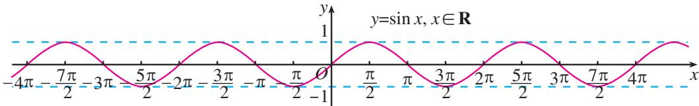

# 5.4.1 正弦函数、余弦函数的图象·思考

思考

根据函数 $y = \sin x, x \in [0, 2\pi]$ 的图象，你能想象函数 $y = \sin x, x \in \mathbf{R}$ 的图象吗？

由诱导公式一可知，函数 $y = \sin x, x \in [2k\pi, 2(k + 1)\pi], k \in \mathbf{Z}$ 且 $k \neq 0$ 的图象与 $y = \sin x, x \in [0, 2\pi]$ 的图象形状完全一致。因此将函数 $y = \sin x, x \in [0, 2\pi]$ 的图象不断向左、向右平移（每次移动 $2\pi$ 个单位长度），就可以得到正弦函数 $y = \sin x, x \in \mathbf{R}$ 的图象（图5.4-4）。

正弦函数的图象叫做正弦曲线（sine curve），是一条“波浪起伏”的连续光滑曲线.

  
图5.4-4

## 所属组织

- [5.4.1 正弦函数、余弦函数的图象](../%E7%9F%A5%E8%AF%86%E4%B8%B2%E8%81%94/%E4%BA%BA%E6%95%99A-%E5%BF%85%E4%BF%AE%E7%AC%AC%E4%B8%80%E5%86%8C/%E6%95%99%E6%9D%90%E9%97%AE%E9%A2%98%E9%A1%BA%E5%BA%8F/%E7%AC%AC%E4%BA%94%E7%AB%A0%20%E4%B8%89%E8%A7%92%E5%87%BD%E6%95%B0/5.4%20%E4%B8%89%E8%A7%92%E5%87%BD%E6%95%B0%E7%9A%84%E5%9B%BE%E8%B1%A1%E4%B8%8E%E6%80%A7%E8%B4%A8/5.4.1%20%E6%AD%A3%E5%BC%A6%E5%87%BD%E6%95%B0%E3%80%81%E4%BD%99%E5%BC%A6%E5%87%BD%E6%95%B0%E7%9A%84%E5%9B%BE%E8%B1%A1.md)
