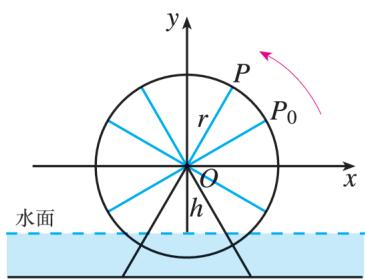

# 5.6.1 匀速圆周运动的数学模型·思考

思考

与盛水筒运动相关的量有哪些？它们之间有怎样的关系？

如图 5.6-3，将筒车抽象为一个几何图形，设经过 t s 后，盛水筒 M 从点 $P_{0}$ 运动到点 P。由筒车的工作原理可知，这个盛水筒距离水面的高度 H，由以下量所决定：筒车转轮的中心 O 到水面的距离 h，筒车的半径 r，筒车转动的角速度 $\omega$ ，盛水筒的初始位置 $P_{0}$ 以及所经过的时间 t。

下面我们分析这些量的相互关系，进而建立盛水筒 $M$ 运动的数学模型.

如图 5.6-3，以 O 为原点，以与水平面平行的直线为 x 轴建立直角坐标系。设 t=0 时，盛水筒 M 位于点 $P_{0}$ ，以 Ox 为始边， $OP_{0}$ 为终边的角为 $\varphi$ ，经过 t s 后运动到点 $P(x, y)$ 。于是，以 Ox 为始边，OP 为终边的角为 $\omega t + \varphi$ ，并且有

$$
y = r \sin (\omega t + \varphi).\tag{①}
$$

所以，盛水筒 M 距离水面的高度 H 与时间 t 的关系是

$$
H = r \sin (\omega t + \varphi) + h.\tag{②}
$$

函数②就是要建立的数学模型，只要将它的性质研究清楚，就能把握盛水筒的运动规律。由于 h 是常量，我们可以只研究函数①的性质。

图5.6-3

## 所属组织

- [5.6.1 匀速圆周运动的数学模型](../%E7%9F%A5%E8%AF%86%E4%B8%B2%E8%81%94/%E4%BA%BA%E6%95%99A-%E5%BF%85%E4%BF%AE%E7%AC%AC%E4%B8%80%E5%86%8C/%E6%95%99%E6%9D%90%E9%97%AE%E9%A2%98%E9%A1%BA%E5%BA%8F/%E7%AC%AC%E4%BA%94%E7%AB%A0%20%E4%B8%89%E8%A7%92%E5%87%BD%E6%95%B0/5.6%20%E5%87%BD%E6%95%B0%20y%20%3D%20A%20sin%28%CF%89x%20%2B%20%CF%86%29/5.6.1%20%E5%8C%80%E9%80%9F%E5%9C%86%E5%91%A8%E8%BF%90%E5%8A%A8%E7%9A%84%E6%95%B0%E5%AD%A6%E6%A8%A1%E5%9E%8B.md)
